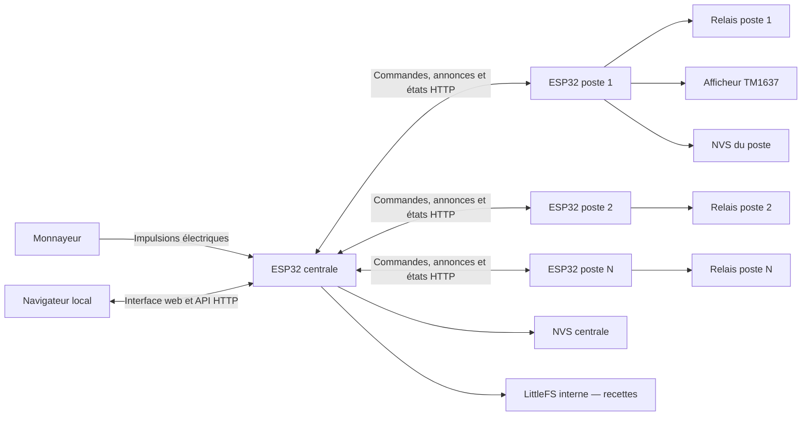
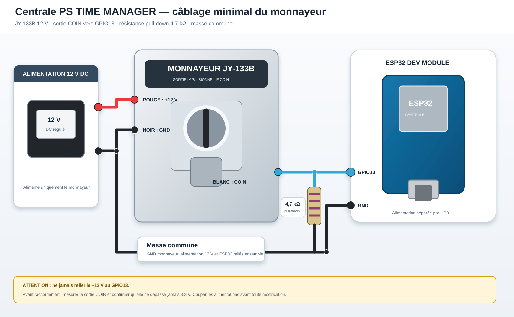
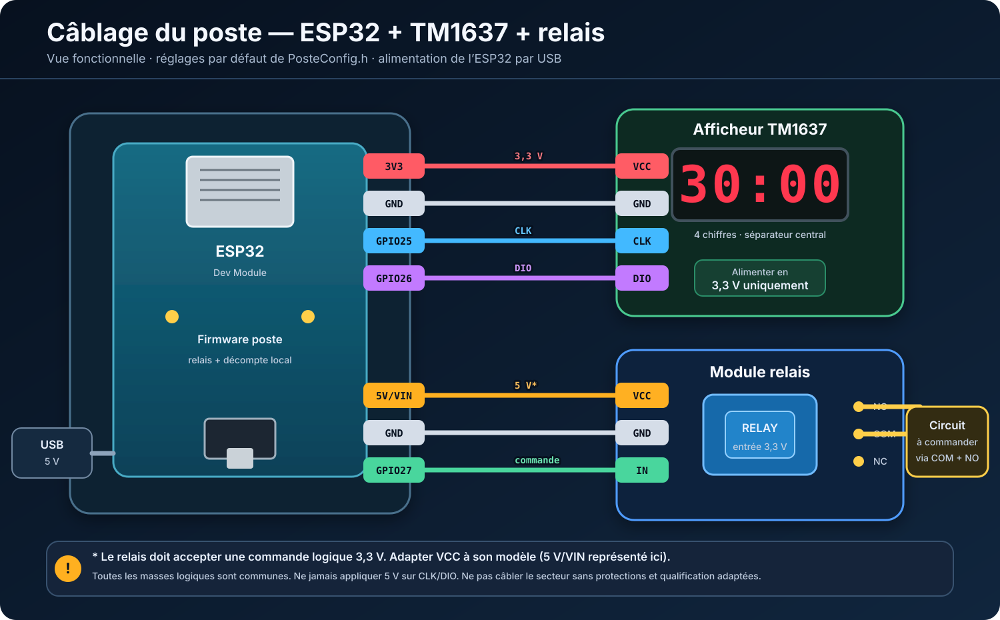

# PS TIME MANAGER sur ESP32

Ce dépôt contient les deux firmwares Arduino qui composent un système local de
gestion de postes de jeu à monnayeur :

- **`central-esp32`** : la centrale reçoit les impulsions du monnayeur, conserve
  le solde de coins, journalise la recette dans LittleFS et distribue du temps de
  jeu depuis une interface web ;
- **`poste-esp32`** : le contrôleur installé sur chaque poste reçoit la durée de
  jeu, commande un relais, affiche le temps restant sur un TM1637 et renvoie son
  état à la centrale.

Chaque dossier est un sketch Arduino autonome à compiler et à téléverser sur un
ESP32 différent. Une centrale peut piloter plusieurs postes qui exécutent tous
le même firmware, avec une identité propre enregistrée en mémoire.

## Documentation

- [Guide technique client (PDF)](output/pdf/ps-time-manager-guide-technique-client.pdf) :
  installation de l'environnement, matériel, sécurité électrique, câblage de la
  centrale et des postes, compilation, mise en réseau, API, persistance et
  recette de mise en service ;
- [Manuel d'utilisation (PDF)](output/pdf/ps-time-manager-manuel-utilisation.pdf) :
  parcours illustré pour l'administrateur et l'utilisateur simple, avec les
  écrans de connexion, postes, recette, comptes, sécurité, journal et Wi-Fi ;
- [Manuel complet de la centrale](central-esp32/README.md)
- [Manuel complet d'un poste](poste-esp32/README.md)
- [Sources de la documentation illustrée](docs/manuals/README.md)

Les README de la centrale et du poste détaillent la mise en service, toutes les
routes HTTP, les exemples `curl`, la persistance, le dépannage et les limites
propres à chaque firmware. Le présent README décrit surtout l'architecture et le
fonctionnement du système complet.

Les captures publiées dans les PDF proviennent des pages HTML réellement
embarquées dans les firmwares. Le serveur de démonstration local injecte
uniquement des postes, comptes, réseaux Wi-Fi, événements et valeurs de recette
fictifs : aucune donnée NVS, adresse ou identité issue d'une installation réelle
n'est utilisée.

## État de la version finale

Cette version a été auditée et recompilée le **25 août 2026** avec la chaîne
d'outils suivante :

| Élément | Version ou valeur validée |
|---|---|
| Arduino IDE | 2.3.10 |
| `arduino-cli` | 1.5.1 |
| Cœur de cartes | `esp32 by Espressif Systems` 3.3.11 |
| Bibliothèque externe | ArduinoJson 7.4.3 |
| Carte de référence | `ESP32 Dev Module`, flash 4 Mo, PSRAM désactivée |
| Moniteur série | 115200 bauds |

Les deux sketches compilent avec cette configuration. La centrale occupe
1 560 932 octets et le poste 1 134 216 octets dans la compilation de référence.
Ces tailles peuvent légèrement varier avec une autre version du compilateur ;
il faut donc conserver les versions ci-dessus pour reproduire exactement la
validation finale.

## Architecture générale



La centrale est le point de décision. Un poste ne compte pas les pièces et ne
gère pas le solde : il exécute uniquement les commandes de session reçues et
maintient son relais actif pendant la durée demandée.

## Fonctionnement du système

### 1. Démarrage de la centrale

La centrale charge depuis sa mémoire NVS :

- la configuration des coins ;
- le solde disponible ;
- les comptes et le token de l'API ;
- la liste des postes connus ;
- les identifiants Wi-Fi.

Elle crée ou migre ensuite le compte administrateur, se connecte au Wi-Fi et
publie `http://pstm.local` avec mDNS. Si aucun réseau valide n'est enregistré,
elle ouvre un point d'accès `GAMEROOM-CENTRAL-<chipId>` et son portail captif.

### 2. Démarrage d'un poste

Le poste calcule son `chipId` matériel, charge son identité et ses identifiants
Wi-Fi depuis la NVS, force le relais à l'arrêt puis initialise son afficheur
TM1637 à `00:00` ou avec le temps récupérable. Il démarre ensuite une tâche
FreeRTOS prioritaire qui contrôle le relais et l'afficheur toutes les 20 ms,
indépendamment du réseau. En cas d'échec Wi-Fi, il ouvre un point d'accès
`GAMEROOM-POSTE-<chipId>`.

Une fois connecté, il publie son propre service mDNS, résout `pstm.local`, garde
l'adresse IP centrale en cache et annonce son état toutes les cinq secondes ou
après une transition de session.

### 3. Découverte et configuration

Un poste neuf n'a pas encore de nom. Son annonce le place dans la liste des
postes découverts de la centrale. Depuis l'interface d'administration, on lui
attribue uniquement un nom visible, par exemple `Poste 1`. La centrale utilise
automatiquement le `chipId` matériel comme identifiant technique unique et ne le
demande pas à l'utilisateur.

La centrale transmet cette identité à `POST /configure`. Les deux appareils la
sauvegardent ensuite dans leur NVS. Une annonce absente pendant 30 secondes fait
disparaître un poste non encore configuré de la liste d'attente.

### 4. Réception d'une pièce

Le monnayeur est lu sur le GPIO 13 de la centrale, avec pull-up interne et
comptage par interruption de chaque front descendant (entrée active LOW,
réglage NO conseillé). Au démarrage du service, les impulsions sont ignorées
pendant 5 secondes, puis l'entrée doit être revenue à HIGH avant son armement.
Le log `Monnayeur prêt` confirme que les pièces peuvent être introduites.
Un verrouillage anti-doublon de 320 ms sépare ensuite les fronts acceptés,
sans délai bloquant ni validation de durée d'impulsion. Le nombre d'impulsions
requis par coin est configurable ;
chaque groupe complet augmente le solde central persistant. Chaque impulsion
validée ajoute en parallèle sa valeur monétaire au journal LittleFS, sans attendre
qu'un groupe de crédit soit complet.

Valeurs par défaut :

| Paramètre | Valeur |
|---|---:|
| Impulsions par coin | 1 |
| Valeur d'une impulsion | 1 000 millimes (1 TND) |
| Durée par coin | 1 800 s, soit 30 min |
| Solde initial | 0 coin |

La règle est donc :

```text
recette = impulsions validées × valeur d'une impulsion
coins créés = floor((reliquat + impulsions validées) / impulsions par coin)
```

Avec une impulsion valant 1 TND, `Impulsions par coin = 1` crée un coin après
1 TND, tandis que `Impulsions par coin = 2` crée un coin après 2 TND. Pour un
monnayeur multi-pièces, une base de 500 millimes permet par exemple de programmer
1, 2, 4 et 10 impulsions pour les pièces de 0,5, 1, 2 et 5 TND.
Ces trains de véritables impulsions multiples nécessitent un réglage de
`COIN_DEBOUNCE_MS` inférieur à leur espacement. Le réglage actuel de 320 ms
reproduit la protection du projet de référence, avec une impulsion utile par pièce.

### 5. Affectation du temps à un poste

Lorsqu'un utilisateur affecte des coins, la centrale calcule :

```text
durée envoyée = coins affectés × durée d'un coin
```

Elle envoie ensuite au poste :

- `START_SESSION` si le poste est inactif ;
- `ADD_TIME` s'il est déjà actif ;
- `STOP_SESSION` lors d'un arrêt manuel.

Les coins ne sont débités qu'après une réponse HTTP réussie du poste. Sur le
poste, `START_SESSION` active le relais et fixe la date de fin ; `ADD_TIME`
prolonge cette date. La tâche de contrôle coupe automatiquement le relais avec
une granularité de 20 ms quand le temps arrive à zéro. Chaque poste affiche en
parallèle son propre décompte en `MM:SS` sous une heure, puis en `HH:MM` jusqu'à
`99:59`. Les commandes et les annonces utilisent des instantanés protégés de la
session afin de conserver un état cohérent entre les deux ESP32.

### 6. Supervision

En plus des annonces, la centrale interroge un poste configuré toutes les cinq
secondes, à tour de rôle, avec `GET /status`. Elle affiche son état, son IP, le
relais et le temps restant. Un poste sans réponse valide depuis plus de dix
secondes passe à l'état `offline`. Une transition de session déclenche aussi une
annonce accélérée du poste ; si l'état change pendant un envoi, une révision
interne provoque immédiatement l'envoi de l'instantané plus récent.

### 7. Recette administrateur

Après synchronisation NTP, la centrale écrit chaque encaissement sous forme
binaire compacte dans `/revenue.bin` sur LittleFS. La page admin **Recette**
agrège ce journal par heure pour un jour, par jour pour une semaine ou par jour
pour un mois. Elle combine cartes de synthèse, graphique en barres et tableau,
puis exporte le résultat en CSV ou en véritable fichier PDF.

La valeur est figée dans chaque écriture : changer le réglage de l'impulsion ne
modifie jamais l'historique. Les crédits simulés et corrections manuelles du
solde sont volontairement exclus de la recette.

### 8. Reprise après une coupure électrique

Pendant une session, chaque poste enregistre un instantané du temps restant dans
sa NVS au démarrage de la session, après chaque ajout de temps, puis toutes les
60 secondes. Si le poste redémarre alors qu'un instantané actif existe :

1. le relais reste coupé pour éviter une reprise non contrôlée ;
2. le poste passe à l'état `recovery_pending` ;
3. il annonce séparément le temps récupérable à la centrale ;
4. la centrale affiche **Reprise en attente** sur la carte du poste concerné ;
5. l'opérateur peut **Reprendre** le temps sauvegardé ou l'**Annuler**.

Chaque poste possède son propre état de reprise. Plusieurs sessions interrompues
peuvent donc être traitées indépendamment depuis la centrale. Une relance envoie
`START_SESSION` avec le temps sauvegardé. Une annulation envoie `STOP_SESSION`
et efface définitivement l'instantané du poste.

L'ESP32 ne disposant pas ici d'une horloge secourue, le temps passé hors tension
n'est pas déduit. Avec l'intervalle par défaut, le temps proposé peut également
être supérieur au temps réel d'au plus environ 60 secondes.

## Communication entre les deux firmwares

Les ESP32 doivent être sur un réseau local qui autorise les communications entre
clients et la résolution mDNS.

| Sens | Route | Rôle |
|---|---|---|
| Poste vers centrale | `POST /poste/announce` | Annonce l'identité, l'IP, l'état, le relais et le temps restant. |
| Centrale vers poste | `GET /status` | Lit l'état courant du poste. |
| Centrale vers poste | `POST /configure` | Attribue ou modifie l'identité logique. |
| Centrale vers poste | `POST /identity/clear` | Efface l'identité et remet le poste en découverte. |
| Centrale vers poste | `POST /command` | Envoie `START_SESSION`, `ADD_TIME`, `STOP_SESSION` ou `PING`. |

La centrale expose également `POST /recovery/resume` et
`POST /recovery/cancel` aux comptes connectés et aux clients possédant son token
API. Ces routes règlent individuellement la reprise de chaque poste.

Les annonces et commandes utilisent un secret Bearer partagé. Ces deux
constantes doivent contenir exactement la même valeur :

```cpp
// central-esp32/AppConfig.h
POSTE_COMMAND_TOKEN

// poste-esp32/PosteConfig.h
COMMAND_TOKEN
```

Ce secret inter-ESP32 est distinct du token API généré par la centrale pour les
clients externes.

## Interface et droits

La centrale fournit une interface web responsive sur son IP et sur
`http://pstm.local`.

| Fonction | Administrateur | Utilisateur simple |
|---|:---:|:---:|
| Voir les postes et le solde | Oui | Oui |
| Affecter des coins et arrêter une session | Oui | Oui |
| Relancer ou annuler une session interrompue | Oui | Oui |
| Simuler une pièce | Oui | Non |
| Configurer ou supprimer les postes | Oui | Non |
| Modifier la configuration et le Wi-Fi | Oui | Non |
| Consulter et exporter la recette | Oui | Non |
| Gérer les comptes, les logs et le token API | Oui | Non |

Dans **Vue des postes**, le bouton **Masquer les cartes** / **Afficher les cartes**
permet de replier collectivement les cinq indicateurs supérieurs (coins, durée,
postes actifs, postes hors ligne et reprises). Le choix est mémorisé dans le
navigateur et ne suspend pas l'actualisation des données masquées.

Au premier démarrage, le compte est `admin` avec le mot de passe `12345678`.
Il doit être modifié immédiatement. Les mots de passe sont salés et hachés en
SHA-256 avant leur stockage ; les sessions web restent uniquement en RAM.

La page **Configuration** permet aussi d'exporter et de restaurer une sauvegarde
JSON complète : paramètres de coins, valeur de l'impulsion, solde, token API, utilisateurs avec leurs
identifiants chiffrés, postes configurés, réglages Wi-Fi/IP et préférence
d'affichage des cartes d'indicateurs. Une restauration ferme les sessions web,
applique cette préférence dans le navigateur courant et demande une nouvelle
connexion. Le fichier contient des données sensibles et doit être protégé.

## Matériel et câblage

### Nomenclature minimale

- un ESP32 pour la centrale ;
- un ESP32 par poste de jeu ;
- un monnayeur à impulsions dont la sortie `COIN` ne dépasse pas 3,3 V ;
- une sortie collecteur ouvert compatible 3,3 V ou une interface de signal adaptée ;
- un module relais adapté à chaque charge ;
- un afficheur quatre chiffres TM1637 à quatre broches pour chaque poste ;
- un réseau Wi-Fi local ;
- des alimentations adaptées et un câblage sécurisé.

| Partie | Éléments spécifiques |
|---|---|
| Centrale | ESP32 4 Mo, monnayeur JY-133B ou équivalent, alimentation 12 V du monnayeur, sortie compatible 3,3 V ou interface adaptée et pull-up interne activé. L'ESP32 est alimenté séparément par USB. |
| Chaque poste | ESP32 4 Mo, module relais compatible avec une commande logique 3,3 V, afficheur TM1637 quatre broches, alimentation adaptée au relais et à la machine. |
| Réseau | Point d'accès ou routeur Wi-Fi local sans isolation entre clients, avec mDNS si l'accès par `pstm.local` est souhaité. |

### Outillage recommandé

| Outil | Utilisation |
|---|---|
| Ordinateur avec Arduino IDE 2 ou `arduino-cli` | Compilation, téléversement et moniteur série. |
| Câbles USB de données | Programmation de la centrale et des postes. |
| Multimètre numérique | Contrôle des masses, des alimentations et du niveau maximal de 3,3 V sur la sortie `COIN`. |
| Alimentation de laboratoire limitée en courant, si disponible | Premier démarrage et recherche de court-circuit sans exposer tout le système. |
| Fer à souder, gaine thermorétractable et étain | Assemblage durable de la partie basse tension. |
| Pince à dénuder, pince à sertir et petits tournevis isolés | Préparation des conducteurs et borniers. |
| Analyseur logique ou oscilloscope, facultatif | Vérification des impulsions du monnayeur et du bus TM1637. |

Toujours effectuer le premier téléversement avec le monnayeur, le relais et la
charge de puissance débranchés. Couper toutes les alimentations avant de
modifier un raccordement.

### Raccordement de la centrale

Le firmware utilise le pull-up interne vers 3V3 pour une sortie `COIN` à
collecteur ouvert vers GND ou une interface compatible 0–3,3 V vérifiée.
Retirer toute résistance de 2 kΩ ou 4,7 kΩ entre GPIO13 et GND, alimentations
coupées. Une sortie à tension plus élevée nécessite une interface adaptée ;
le pull-up interne ne convertit pas du 5 V ou du 12 V en 3,3 V. Voir le
[diagnostic du monnayeur](central-esp32/README.md#les-coins-ne-sont-pas-détectés)
avant de modifier le câblage.

La centrale utilise le GPIO 13 pour le monnayeur. NVS et LittleFS utilisent la
flash interne et n'ajoutent aucun câblage. Le schéma final est disponible ici :



Le [tableau de raccordement broche par broche](central-esp32/README.md#câblage-final-de-la-centrale)
complète le dessin et doit être vérifié avec les noms sérigraphiés sur le modèle
réel de l'ESP32.

| Depuis | Vers | Fonction |
|---|---|---|
| Alimentation `+12 V` | Fil rouge du monnayeur | Alimentation du monnayeur. |
| Alimentation `GND` | Fil noir du monnayeur et `GND` de l'ESP32 | Masse commune. |
| Fil blanc `COIN` du monnayeur | ESP32 `GPIO13` | Signal impulsionnel, après contrôle qu'il reste inférieur ou égal à 3,3 V. |
| Pull-up interne `INPUT_PULLUP` | GPIO13 vers 3V3, dans l'ESP32 | Activé par le firmware ; aucune résistance externe vers GND. |

L'ESP32 est alimenté séparément par USB. Avant de relier le fil blanc à
`GPIO13`, mesurer la sortie `COIN` et vérifier qu'elle ne reçoit jamais plus de
**3,3 V**.

### Raccordement d'un poste

Le firmware du poste utilise le GPIO 27 pour le relais, le GPIO 25 pour `CLK` et
le GPIO 26 pour `DIO`. Le schéma complet de la partie poste est disponible ici :



| ESP32 | Équipement | Fonction |
|---|---|---|
| `3V3` | TM1637 `VCC` | Alimentation sûre des résistances de rappel du module. |
| `GND` | TM1637 `GND` et relais `GND` | Masse logique commune. |
| GPIO 25 | TM1637 `CLK` | Horloge. |
| GPIO 26 | TM1637 `DIO` | Données. |
| GPIO 27 | Relais `IN` | Commande logique. |
| Alimentation adaptée | Relais `VCC` | 5 V sur le schéma, à confirmer avec le module réel. |
| Contacts `COM` et `NO` du relais | Circuit d'autorisation de la machine | Contact sec, séparé de `IN`; `NC` reste inutilisé dans le montage de référence. |

Avant de connecter une machine, il faut vérifier `RELAY_PIN`, adapter
`RELAY_ACTIVE_HIGH` au module relais et alimenter le TM1637 en 3,3 V. Son pilote
est inclus dans le firmware et ne nécessite aucune bibliothèque supplémentaire.

> Ne jamais relier le `+12 V` au GPIO13. Le montage minimal présenté suppose que
> la sortie `COIN` a été mesurée à 3,3 V maximum. Le câblage secteur doit être
> confié à une personne qualifiée.

## Installation de l'environnement et téléversement

Cette procédure part d'une installation neuve d'Arduino IDE 2 et va jusqu'au
premier démarrage des deux firmwares. Le projet a été vérifié avec le cœur ESP32
3.3.11 et ArduinoJson 7.4.3.

### Dépendances par firmware

| Élément | Centrale | Poste | Installation |
|---|:---:|:---:|---|
| `esp32 by Espressif Systems` 3.3.11 | Oui | Oui | Gestionnaire de cartes Arduino ou `arduino-cli core install esp32:esp32@3.3.11`. |
| ArduinoJson 7.4.3 | Oui | Oui | Gestionnaire de bibliothèques ou `arduino-cli lib install ArduinoJson@7.4.3`. |
| `WiFi`, `WebServer`, `DNSServer`, `Preferences`, `ESPmDNS`, `HTTPClient` | Oui | Oui | Inclus automatiquement dans le cœur ESP32. |
| `FS`, `LittleFS`, mbedTLS | Oui | Non | Inclus automatiquement dans le cœur ESP32. |
| FreeRTOS | Non directement | Oui | Inclus automatiquement dans le cœur ESP32. |
| Pilote TM1637 externe | Non | **Non requis** | Le pilote est implémenté dans `DisplayService.cpp`. |

Ne pas installer séparément des bibliothèques homonymes à `WiFi`, `WebServer`,
`Preferences` ou `LittleFS` : le projet doit utiliser celles fournies avec le
cœur ESP32 3.3.11.

Avec ArduinoJson 7.4.3 et le niveau d'avertissement maximal, le compilateur peut
signaler les anciennes formes `StaticJsonDocument`, `DynamicJsonDocument`,
`createNestedArray` ou `createNestedObject` comme dépréciées. Ces avertissements
de compatibilité ne bloquent ni la compilation ni le téléversement de cette
version finale.

### 1. Installer Arduino IDE

1. Télécharger **Arduino IDE 2** depuis la
   [page officielle Arduino](https://www.arduino.cc/en/software).
2. Installer puis démarrer l'application.
3. Sous macOS, autoriser l'application si le système le demande. Sous Windows,
   accepter l'installation du pilote série proposé avec la carte.

Voir également le
[guide officiel d'installation d'Arduino IDE](https://support.arduino.cc/hc/en-us/articles/360019833020-Download-and-install-Arduino-IDE).

### 2. Ajouter les cartes ESP32 à Arduino IDE

1. Ouvrir **Arduino IDE → Settings** sur macOS ou
   **File → Preferences** sous Windows/Linux.
2. Dans **Additional Boards Manager URLs**, ajouter l'adresse stable officielle :

   ```text
   https://espressif.github.io/arduino-esp32/package_esp32_index.json
   ```

   Si une autre adresse est déjà présente, ajouter celle-ci sur une nouvelle
   ligne ou la séparer par une virgule.
3. Ouvrir **Tools → Board → Boards Manager**.
4. Rechercher `esp32` puis installer **esp32 by Espressif Systems**.
5. Redémarrer Arduino IDE après l'installation.

La procédure et l'URL sont publiées dans la
[documentation officielle Arduino-ESP32](https://docs.espressif.com/projects/arduino-esp32/en/latest/installing.html).

### 3. Installer les bibliothèques nécessaires

La seule bibliothèque à installer séparément est :

- **ArduinoJson**, par Benoit Blanchon — version 7.4.3 testée.

Dans Arduino IDE :

1. Ouvrir **Tools → Manage Libraries** ou l'icône **Library Manager** dans la
   barre latérale.
2. Rechercher `ArduinoJson`.
3. Sélectionner la bibliothèque de **Benoit Blanchon**, puis cliquer sur
   **Install**.

`WiFi`, `WebServer`, `DNSServer`, `Preferences`, `ESPmDNS`, `HTTPClient` et
mbedTLS sont installés automatiquement avec **esp32 by Espressif Systems**. Il
ne faut pas installer d'autres bibliothèques portant ces noms. Voir le
[guide officiel du gestionnaire de bibliothèques](https://support.arduino.cc/hc/en-us/articles/5145457742236-Add-libraries-to-Arduino-IDE).

### 4. Brancher et sélectionner l'ESP32

1. Utiliser un câble USB qui transporte les **données** et pas uniquement
   l'alimentation.
2. Pour le premier essai, débrancher le monnayeur, le relais et toute charge de
   puissance de la carte.
3. Brancher l'ESP32 au PC.
4. Sélectionner **Tools → Board → ESP32 Arduino → ESP32 Dev Module**, ou le
   modèle exact de la carte s'il est connu.
5. Sélectionner le port dans **Tools → Port**.

Si aucun port n'apparaît, essayer un autre câble ou port USB, puis installer le
pilote correspondant au convertisseur USB-série de la carte, souvent CP210x ou
CH340. La sélection correcte de la carte est détaillée dans le
[guide Espressif du menu Tools](https://docs.espressif.com/projects/arduino-esp32/en/latest/guides/tools_menu.html).

### 5. Régler la carte et les partitions

Utiliser les réglages suivants pour une carte ESP32 classique avec 4 Mo de
flash :

Pour changer le schéma de la **centrale** dans Arduino IDE 2 :

1. Ouvrir `central-esp32/central-esp32.ino` directement depuis le dossier du
   projet. Le fichier `central-esp32/partitions.csv` doit rester à côté du
   fichier `.ino`.
2. Aller dans **Tools/Outils → Board/Type de carte → esp32 → ESP32 Dev Module**.
3. Aller dans **Tools/Outils → Flash Size → 4MB (32Mb)**.
4. Aller dans **Tools/Outils → Partition Scheme/Schéma de partition** et choisir
   **Minimal SPIFFS (1.9MB APP with OTA/128KB SPIFFS)**.
5. Régler **Erase All Flash Before Sketch Upload → Disabled** pour conserver la
   configuration NVS existante.
6. Choisir le port USB de la centrale, puis lancer **Verify/Vérifier** et
   **Upload/Téléverser**.

Le texte « 128KB SPIFFS » est seulement le nom du profil Arduino sélectionné.
Lors de la compilation de ce sketch, le fichier local `partitions.csv` remplace
ce découpage standard et réserve réellement **640 Kio à LittleFS**. Ne pas
renommer, déplacer ou supprimer ce fichier. Ne pas choisir **Default** pour la
centrale : sa limite d'application est trop petite pour le firmware actuel.

Table réellement écrite depuis `central-esp32/partitions.csv` :

| Partition | Offset | Taille | Utilisation |
|---|---:|---:|---|
| `nvs` | `0x9000` | 20 Kio | Wi-Fi, configuration, comptes, token et postes. |
| `otadata` | `0xE000` | 8 Kio | Sélection des emplacements applicatifs. |
| `app0` | `0x10000` | 1,625 Mio | Firmware actif. |
| `app1` | `0x1B0000` | 1,625 Mio | Second emplacement applicatif. |
| `littlefs` | `0x350000` | 640 Kio | Journal `/revenue.bin`. |
| `coredump` | `0x3F0000` | 64 Kio | Diagnostic ESP32. |

Le profil **Minimal SPIFFS** est requis pour que l'outil accepte la taille de la
centrale, mais la limite physique à respecter reste celle de `app0`, soit
**1 703 936 octets**. La version finale utilise environ 91,6 % de cet espace et
laisse approximativement 143 004 octets. Le pourcentage affiché par Arduino IDE
est calculé avec le profil de menu et peut donc être plus optimiste. Après toute
extension du firmware, comparer impérativement la taille compilée à 1 703 936.

La table comporte deux emplacements OTA, mais le firmware n'implémente pas de
procédure de mise à jour OTA. Les téléversements documentés ici se font par USB.

| Réglage Arduino IDE | Centrale | Poste |
|---|---|---|
| Board | ESP32 Dev Module | ESP32 Dev Module |
| Flash Size | 4MB | 4MB |
| Partition Scheme | **Minimal SPIFFS** (remplacé par le `partitions.csv` local) | Default 4MB with spiffs |
| CPU Frequency | 240 MHz (WiFi/BT) | 240 MHz (WiFi/BT) |
| Flash Frequency / Mode | 80 MHz / QIO | 80 MHz / QIO |
| PSRAM | Disabled | Disabled |
| Upload Speed | 460800, ou 115200 en cas d'échec | 460800, ou 115200 en cas d'échec |
| Erase All Flash Before Sketch Upload | Disabled | Disabled |
| Port | Port USB de la centrale | Port USB du poste concerné |

La centrale embarque désormais le fond de connexion et les logos en WebP haute
qualité. Le fichier [`central-esp32/partitions.csv`](central-esp32/partitions.csv)
applique un découpage personnalisé : deux applications OTA de 1,625 Mio,
640 Kio de LittleFS et la NVS conservée à son emplacement habituel. Le poste
n'embarque pas ces images et reste sur le schéma 4 Mo par défaut.

Après ce changement, effectuer un téléversement complet de la centrale par USB
afin d'écrire la table de partitions. LittleFS sera initialisé automatiquement.
Ne pas activer **Erase All Flash** sauf nécessité : ce réglage efface aussi le
Wi-Fi, les comptes et les postes stockés en NVS.

### 6. Préparer la configuration du projet

Avant de compiler :

1. Dans [`central-esp32/AppConfig.h`](central-esp32/AppConfig.h), remplacer
   `POSTE_COMMAND_TOKEN` par un secret long et vérifier `COIN_PIN`, actuellement
   réglé sur le GPIO 13.
2. Dans [`poste-esp32/PosteConfig.h`](poste-esp32/PosteConfig.h), copier
   exactement le même secret dans `COMMAND_TOKEN`.
3. Vérifier `RELAY_PIN`, actuellement GPIO 27, et adapter
   `RELAY_ACTIVE_HIGH` au module relais utilisé. Vérifier également le câblage
   de l'afficheur : `TM1637_CLK_PIN` sur GPIO 25 et `TM1637_DIO_PIN` sur GPIO 26.

La centrale ne contient pas d'identifiants Wi-Fi compilés. Sur le poste, laisser
`WIFI_SSID="YOUR_WIFI"` et `WIFI_PASSWORD="YOUR_PASSWORD"` pour utiliser le
portail, ou remplacer ces deux valeurs uniquement si un réseau de secours doit
être intégré au firmware. Dans le parcours recommandé, les identifiants sont
saisis dans les portails de configuration puis conservés en NVS.

### 7. Compiler et téléverser la centrale

1. Ouvrir [`central-esp32/central-esp32.ino`](central-esp32/central-esp32.ino).
2. Vérifier de nouveau **Tools/Outils → Partition Scheme/Schéma de partition →
   Minimal SPIFFS (1.9MB APP with OTA/128KB SPIFFS)**.
3. Cliquer sur **Verify** pour compiler.
4. Cliquer sur **Upload** pour téléverser le firmware.
5. Si Arduino reste sur `Connecting...`, maintenir le bouton **BOOT** de
   l'ESP32, lancer le téléversement, puis relâcher BOOT dès que l'écriture
   commence. Appuyer ensuite brièvement sur **EN/RESET** si nécessaire.
6. Ouvrir **Tools → Serial Monitor** et choisir **115200 baud**.

La centrale démarre soit sur le réseau enregistré, soit avec le point d'accès
`GAMEROOM-CENTRAL-<chipId>`.

### 8. Compiler et téléverser un poste

1. Ouvrir [`poste-esp32/poste-esp32.ino`](poste-esp32/poste-esp32.ino) dans une
   autre fenêtre Arduino IDE.
2. Sélectionner l'ESP32 du poste, son port USB et le schéma de partitions par
   défaut.
3. Cliquer sur **Verify**, puis **Upload**.
4. Ouvrir le moniteur série à **115200 baud**.
5. Vérifier que le TM1637 affiche `00:00` avant de démarrer une session.
6. Répéter l'opération sur chaque poste. Tous utilisent le même firmware et le
   même secret, mais chaque ESP32 possède un `chipId` matériel unique.

### 9. Installation équivalente avec arduino-cli

```bash
arduino-cli config add board_manager.additional_urls https://espressif.github.io/arduino-esp32/package_esp32_index.json
arduino-cli core update-index
arduino-cli core install esp32:esp32@3.3.11
arduino-cli lib install ArduinoJson@7.4.3
arduino-cli board list
```

Compiler et téléverser la centrale :

```bash
arduino-cli compile --fqbn esp32:esp32:esp32:PartitionScheme=min_spiffs central-esp32
arduino-cli upload --fqbn esp32:esp32:esp32:PartitionScheme=min_spiffs --port PORT_CENTRALE central-esp32
```

Compiler et téléverser un poste :

```bash
arduino-cli compile --fqbn esp32:esp32:esp32:PartitionScheme=default poste-esp32
arduino-cli upload --fqbn esp32:esp32:esp32:PartitionScheme=default --port PORT_POSTE poste-esp32
```

Remplacer `PORT_CENTRALE` et `PORT_POSTE` par les valeurs retournées par
`arduino-cli board list`, par exemple `COM5` sous Windows ou
`/dev/cu.usbserial-...` sous macOS.

## Mise en service rapide

1. Couper les alimentations et vérifier tout le câblage au multimètre.
2. Alimenter la centrale séparément par USB et vérifier son démarrage avant de
   raccorder le monnayeur.
3. Remplacer le secret partagé dans les deux firmwares, puis compiler la
   centrale avec **Minimal SPIFFS** et chaque poste avec **Default**.
4. Téléverser d'abord la centrale par USB et ouvrir le moniteur série à 115200
   bauds.
5. Se connecter au réseau `GAMEROOM-CENTRAL-<chipId>`, ouvrir
   `http://192.168.4.1` et sélectionner le réseau local.
6. Ouvrir l'IP annoncée ou `http://pstm.local`, se connecter avec
   `admin` / `12345678`, puis changer immédiatement le mot de passe.
7. Régénérer le token API et exporter une première sauvegarde JSON protégée.
8. Téléverser un poste, rejoindre au besoin `GAMEROOM-POSTE-<chipId>`, puis le
   connecter au même réseau local que la centrale.
9. Dans **Gestion des postes**, attendre sa découverte et lui attribuer un nom.
10. Vérifier `00:00` sur le TM1637, effectuer un ping et lancer une courte
    session de test sans charge de puissance.
11. Vérifier le niveau actif du relais ; inverser `RELAY_ACTIVE_HIGH` et
    retéléverser si le module fonctionne à l'état bas.
12. Raccorder ensuite la charge, affecter un coin et confirmer l'arrêt automatique.
13. Introduire une impulsion réelle et vérifier simultanément le solde, les logs
    et la page **Recette** après synchronisation NTP.
14. Redémarrer un poste pendant une session de test et valider les deux choix
    **Reprendre** et **Annuler**.

## Persistance et redémarrage

| Appareil | Namespace NVS | Données conservées |
|---|---|---|
| Centrale | `wifi` | SSID, mot de passe et configuration DHCP ou IPv4 statique. |
| Centrale | `appcfg` | Durée, impulsions par coin, valeur en millimes, solde et reliquat. |
| Centrale | `auth` | Comptes, hashes salés et token API. |
| Centrale | `posts` | Identité et dernière IP des postes configurés. |
| Centrale | `revenue` | Marqueur d'initialisation de LittleFS ; aucune recette n'est stockée en NVS. |
| Poste | `wifi` | SSID, mot de passe et configuration DHCP ou IPv4 statique. |
| Poste | `identity` | Identifiant logique et nom du poste. |
| Poste | `session` | Dernier temps restant sauvegardé ; une valeur positive indique une session interrompue. |

La recette financière est stockée séparément dans `/revenue.bin` sur LittleFS.
Elle n'est pas incluse dans l'export JSON de configuration. Les paramètres,
comptes, postes et solde restent dans la NVS. Une compaction automatique
regroupe les anciens événements par heure lorsque l'occupation dépasse 40 %,
sans changer les rapports jour/semaine/mois.

Ne sont pas persistants : les logs et sessions web de la centrale, les postes
en attente et les statuts instantanés. Après le redémarrage d'un poste interrompu,
son relais reste coupé, mais le dernier temps sauvegardé est proposé à la
centrale pour une relance ou une annulation explicite.

## Rôle de chaque fichier

### Firmware de la centrale

| Fichier | Rôle |
|---|---|
| `central-esp32/central-esp32.ino` | Point d'entrée Arduino : crée l'état global et le serveur, initialise les services et exécute leur boucle. |
| `central-esp32/AppConfig.h` | Regroupe les valeurs par défaut, secrets, GPIO, port et délais. |
| `central-esp32/AppState.h` | Définit l'état partagé en RAM : crédits, impulsions, comptes, sessions, logs et postes. |
| `central-esp32/Post.h` | Définit la structure d'un poste configuré, son dernier état connu et une éventuelle reprise en attente. |
| `central-esp32/AuthService.h` | Déclare l'API interne d'authentification et de gestion des utilisateurs. |
| `central-esp32/AuthService.cpp` | Gère les comptes, rôles, hashes de mots de passe, cookies de session et tokens Bearer. |
| `central-esp32/CoinService.h` | Déclare le service de lecture du monnayeur. |
| `central-esp32/CoinService.cpp` | Traite l'interruption GPIO, l'anti-rebond et la conversion des impulsions en coins persistants. |
| `central-esp32/RevenueService.h` / `RevenueService.cpp` | Synchronise l'heure, écrit le journal LittleFS et agrège les recettes. |
| `central-esp32/LogService.h` | Déclare le service de journalisation. |
| `central-esp32/LogService.cpp` | Écrit sur le port série et conserve les 100 derniers événements en RAM. |
| `central-esp32/PostService.h` | Déclare la logique métier de gestion des postes. |
| `central-esp32/PostService.cpp` | Gère découverte, configuration, crédits, arrêt, reprise après coupure, suppression et état hors ligne. |
| `central-esp32/PosteClient.h` | Déclare le client HTTP utilisé pour joindre un poste. |
| `central-esp32/PosteClient.cpp` | Envoie les commandes et configurations au poste, et décode la réponse de `/status`. |
| `central-esp32/StorageService.h` | Déclare la persistance et la sauvegarde/restauration complète. |
| `central-esp32/StorageService.cpp` | Lit et écrit les namespaces NVS et sérialise les données persistantes en JSON. |
| `central-esp32/WifiService.h` | Déclare la connexion normale au réseau et le démarrage mDNS. |
| `central-esp32/WifiService.cpp` | Utilise le Wi-Fi enregistré et publie le service HTTP `pstm.local`. |
| `central-esp32/WifiProvisioning.h` | Déclare le mode de configuration Wi-Fi. |
| `central-esp32/WifiProvisioning.cpp` | Implémente le point d'accès, le DNS captif, le scan, le formulaire et la sauvegarde Wi-Fi. |
| `central-esp32/WebRoutes.h` | Déclare l'enregistrement des routes du serveur web. |
| `central-esp32/WebRoutes.cpp` | Implémente les pages, l'API JSON, les autorisations et la réception des annonces. |
| `central-esp32/WebPage.h` | Déclare les générateurs des pages web embarquées. |
| `central-esp32/WebPage.cpp` | Contient le HTML, le CSS et le JavaScript de la connexion et de l'interface d'administration. |
| `central-esp32/WebAssets.h` / `central-esp32/WebAssets.cpp` | Expose les images WebP HD intégrées au firmware. |
| `central-esp32/*Asset.inc` | Contient les données binaires `PROGMEM` générées depuis les WebP embarqués. |
| `central-esp32/ui-assets/` | Regroupe le logo maître et les variantes WebP HD documentées. |
| `central-esp32/docs/schema-cablage-central-final.svg` | Schéma du monnayeur vers GPIO13 avec pull-up interne sans résistance externe vers GND. |
| `central-esp32/partitions.csv` | Réserve deux partitions OTA de 1,625 Mio et 640 Kio de LittleFS. |
| `central-esp32/README.md` | Manuel détaillé du firmware central, de son interface et de son API. |

### Firmware d'un poste

| Fichier | Rôle |
|---|---|
| `poste-esp32/poste-esp32.ino` | Point d'entrée Arduino : initialise identité, contrôle temps réel, serveur, Wi-Fi et annonces. |
| `poste-esp32/PosteConfig.h` | Regroupe Wi-Fi, mDNS, timeouts, tâche de contrôle, GPIO du relais et du TM1637 et luminosité. |
| `poste-esp32/PosteState.h` | Définit l'identité et l'état réseau partagés ; la session reste privée au service relais. |
| `poste-esp32/PosteControlService.h` / `PosteControlService.cpp` | Exécute le relais et l'afficheur dans une tâche FreeRTOS toutes les 20 ms. |
| `poste-esp32/PosteIdentityService.h` | Déclare la gestion de l'identité persistante. |
| `poste-esp32/PosteIdentityService.cpp` | Calcule le `chipId` eFuse et charge, sauvegarde ou efface `id` et `name` dans la NVS. |
| `poste-esp32/RelayService.h` | Déclare le pilotage du relais et des sessions. |
| `poste-esp32/RelayService.cpp` | Protège l'état de session par mutex, pilote le relais et sauvegarde/restaure le temps récupérable. |
| `poste-esp32/DisplayService.h` / `DisplayService.cpp` | Pilote le TM1637 et affiche le temps local au format `MM:SS` ou `HH:MM`. |
| `poste-esp32/PosteAnnounceService.h` | Déclare l'annonce périodique vers la centrale. |
| `poste-esp32/PosteAnnounceService.cpp` | Met en cache l'IP centrale et envoie les états périodiques ou les transitions en JSON. |
| `poste-esp32/PosteWebServer.h` | Déclare les routes HTTP propres au poste. |
| `poste-esp32/PosteWebServer.cpp` | Implémente `/status`, `/configure`, `/identity/clear`, `/command` et la validation Bearer. |
| `poste-esp32/WiFiConfigService.h` | Déclare l'initialisation et le suivi du Wi-Fi. |
| `poste-esp32/WiFiConfigService.cpp` | Gère les identifiants Wi-Fi, la connexion, le point d'accès, le portail captif et son DNS. |
| `poste-esp32/docs/schema-cablage-poste-tm1637.svg` | Schéma du relais et de l'afficheur TM1637 raccordés à l'ESP32 du poste. |
| `poste-esp32/README.md` | Manuel détaillé du firmware de poste, de son câblage et de son API. |

Les fichiers `.h` définissent les structures et interfaces publiques. Les
fichiers `.cpp` portent leur implémentation, tandis que chaque `.ino` orchestre
le démarrage et la boucle principale de son ESP32.

## Sécurité avant déploiement

Modifier impérativement les valeurs de développement :

- le mot de passe administrateur `12345678` ;
- `AP_PASSWORD` sur la centrale et `WIFI_SETUP_AP_PASSWORD` sur les postes,
  tous deux vides par défaut ;
- le secret partagé `POSTE_COMMAND_TOKEN` / `COMMAND_TOKEN` ;
- le token API de la centrale, depuis l'interface.

Le système utilise HTTP sans TLS. Il doit rester sur un réseau local privé, sans
redirection de port depuis Internet. Le token partagé et les identifiants Wi-Fi
sont présents dans le firmware ou la NVS sans chiffrement applicatif.

## Limites importantes

- une reprise après coupure nécessite une décision manuelle et n'est précise
  qu'à l'intervalle du dernier instantané, 60 secondes par défaut ;
- le temps écoulé pendant la coupure n'est pas déduit sans horloge RTC secourue ;
- le TM1637 plafonne visuellement à `99:59`, même si une session plus longue
  continue d'être gérée normalement ;
- raccourcir fortement l'intervalle de sauvegarde augmente l'usure de la flash ;
- la résolution de `pstm.local` dépend du support mDNS du réseau ;
- les postes sont interrogés séquentiellement, donc un tour complet prend
  environ cinq secondes multipliées par leur nombre ;
- les logs de la centrale sont limités à 100 entrées et perdus au redémarrage ;
- les encaissements avant synchronisation NTP restent enregistrés mais non datés ;
- si LittleFS est indisponible ou plein, les crédits continuent mais la recette correspondante ne peut pas être récupérée ;
- le serveur Arduino convient à un petit réseau local, pas à une exposition
  publique ou à une forte charge ;
- le changement du secret inter-ESP32 exige de recompiler la centrale et tous
  les postes avec exactement la même valeur.
