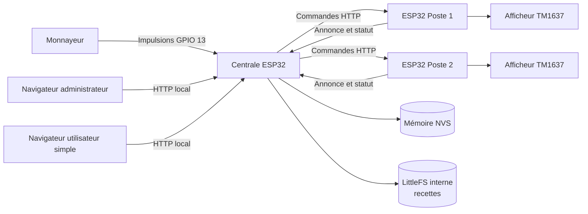

# Centrale ESP32 - PS TIME MANAGER

Firmware de la centrale d'un système de gestion de postes de jeu à monnayeur.
La centrale ESP32 reçoit les impulsions du monnayeur, transforme ces impulsions
en crédits, découvre les ESP32 installés sur les postes et distribue du temps de
jeu depuis une interface web locale.

## Guides PDF

- [Guide technique client](../output/pdf/ps-time-manager-guide-technique-client.pdf)
  pour l'installation, le câblage, le téléversement et la recette technique ;
- [Manuel d'utilisation](../output/pdf/ps-time-manager-manuel-utilisation.pdf)
  pour les parcours administrateur et utilisateur simple.

Toutes les captures de ces guides utilisent des données fictives générées par
le serveur de démonstration documentaire ; elles ne contiennent aucun SSID,
compte, mot de passe, token ou historique provenant d'une centrale réelle.

## Sommaire

- [Guides PDF](#guides-pdf)
- [Fonctions principales](#fonctions-principales)
- [Architecture](#architecture)
- [Démarrage du firmware](#démarrage-du-firmware)
- [Gestion des coins](#gestion-des-coins)
- [Recette dans LittleFS](#recette-dans-littlefs)
- [Câblage final de la centrale](#câblage-final-de-la-centrale)
- [Gestion des postes](#gestion-des-postes)
- [Gestion des utilisateurs](#gestion-des-utilisateurs)
- [Interface web](#interface-web)
- [Installation et compilation](#installation-et-compilation)
- [Manuel d'utilisation](#manuel-dutilisation)
- [API HTTP](#api-http)
- [Persistance des données](#persistance-des-données)
- [Rôle de chaque fichier](#rôle-de-chaque-fichier)
- [Sécurité](#sécurité)
- [Dépannage](#dépannage)
- [Limites connues](#limites-connues)

## Fonctions principales

- configuration Wi-Fi par point d'accès et portail captif ;
- accès local par adresse IP ou `http://pstm.local` ;
- lecture du monnayeur sur le GPIO 13 ;
- conversion configurable des impulsions en coins ;
- valeur configurable de l'impulsion : 500, 1 000, 2 000 ou 5 000 millimes ;
- crédit disponible sauvegardé en mémoire NVS ;
- journal monétaire binaire compact dans LittleFS ;
- recette par jour, semaine ou mois avec graphique, cartes, tableau et exports PDF/CSV ;
- découverte automatique des ESP32 des postes ;
- configuration, renommage et suppression des postes ;
- démarrage, prolongation et arrêt des sessions ;
- détection et traitement indépendant des sessions interrompues après coupure ;
- surveillance de l'état, du relais et du temps restant ;
- interface web responsive embarquée dans le firmware ;
- comptes multiples avec rôles `admin` et `user` ;
- journal des 100 derniers événements ;
- sauvegarde et restauration complètes des réglages et données persistantes ;
- API HTTP protégée par session ou token Bearer.

## Architecture



La centrale est le point de décision du système. Les postes doivent exécuter le
firmware compatible du dossier voisin `../poste-esp32`, qui fournit les
endpoints `/status`, `/command`, `/configure` et `/identity/clear`, commande le
relais et affiche localement le temps restant sur un TM1637. Son contrôle de
session fonctionne dans une tâche FreeRTOS dédiée : les délais mDNS ou HTTP ne
peuvent plus figer l'affichage ni retarder l'expiration du relais.

### Composants internes

| Composant | Responsabilité |
|---|---|
| Point d'entrée Arduino | Initialise les services et exécute la boucle principale. |
| Wi-Fi | Connexion au réseau existant ou ouverture du portail de configuration. |
| Monnayeur | Compte les impulsions et alimente le crédit central. |
| Gestion des postes | Découverte, identité, sessions et surveillance. |
| Client des postes | Échanges HTTP entre la centrale et chaque poste. |
| Authentification | Comptes, mots de passe, sessions et permissions. |
| Stockage | Configuration et solde en NVS ; historique des recettes dans LittleFS. |
| Recette | Horodatage NTP, journal des impulsions, agrégation et exports. |
| Web | Pages HTML/CSS/JavaScript et routes de l'API. |
| Logs | Journal en RAM et sortie série. |

## Démarrage du firmware

La fonction `setup()` exécute les opérations suivantes :

1. ouverture du port série à 115200 bauds ;
2. chargement de la configuration NVS ;
3. création ou migration du compte administrateur ;
4. tentative de connexion au Wi-Fi enregistré pendant 15 secondes ;
5. démarrage du portail Wi-Fi si la connexion échoue ;
6. sinon, démarrage de mDNS et de la synchronisation NTP ;
7. montage de LittleFS, puis démarrage du monnayeur, des postes et du serveur web.

En mode normal, `loop()` traite continuellement :

- les requêtes HTTP ;
- les impulsions reçues du monnayeur ;
- l'état de l'horloge et les nouvelles tentatives de montage LittleFS ;
- l'expiration des postes en attente ;
- l'interrogation périodique des postes configurés.

### Mode de configuration Wi-Fi

Si aucun Wi-Fi valide n'est enregistré, la centrale crée ce point d'accès :

| Paramètre | Valeur par défaut |
|---|---|
| SSID | `GAMEROOM-CENTRAL-<chipId>` |
| Mot de passe | Aucun (réseau ouvert par défaut) |
| Adresse du portail | `http://192.168.4.1` |

Le portail scanne les réseaux disponibles et propose deux modes d'adressage :

- **Automatique (DHCP)**, utilisé par défaut et compatible avec les anciennes
  configurations enregistrées ;
- **Manuel (IP fixe)**, avec adresse IPv4, passerelle, masque de sous-réseau et
  DNS principal/secondaire facultatifs.

Les identifiants et les paramètres réseau sont validés puis enregistrés
uniquement après une connexion réussie. La centrale redémarre ensuite avec la
même configuration. Il n'existe pas de proxy HTTP système sur l'ESP32 : les
communications avec les postes et mDNS restent directes sur le réseau local.
Le suffixe `chipId`, calculé depuis l'eFuse, distingue aussi plusieurs centrales
qui seraient simultanément en mode configuration.

## Gestion des coins

Le signal `COIN`, adapté en logique 0–3,3 V, arrive sur le GPIO 13 configuré en
`INPUT_PULLUP`. Le rappel interne vers **3V3** rétablit le niveau HIGH quand une
sortie à collecteur ouvert vers GND est relâchée. Ce montage ne nécessite pas de
résistance externe de rappel : retirer toute résistance de 2 kΩ ou 4,7 kΩ entre
GPIO13 et GND, alimentations coupées. Pour une liaison non isolée, la masse du
monnayeur et celle de l'ESP32 sont communes. Confirmer que la sortie ne fournit
aucune tension supérieure à 3,3 V, ou utiliser une interface adaptée au monnayeur.
Le nom JY-133B et le réglage NO/NC ne suffisent pas à garantir le type électrique
de la sortie. Une résistance pull-down seule ne convertit pas du 5 V ou du 12 V
en 3,3 V. Ne jamais relier le `+12 V` au GPIO13.

Comme dans le projet de référence fonctionnel, l'entrée est active à LOW.
Le réglage **NO** est conseillé : repos HIGH, impulsion LOW. Le firmware compte
un front descendant par interruption, sans attendre la fin de l'impulsion et
sans limite de durée minimale ou maximale. Après un front accepté, un verrouillage
anti-doublon de **320 ms** ignore les fronts suivants avant qu'ils n'alimentent
les crédits ou la recette, sans attente bloquante. Les fronts ignorés ne prolongent
pas ce verrouillage. Il reprend le délai effectif du projet de référence :
`timer = 20` tours de boucle × 4 chiffres × `delay(4)`, soit environ 320 ms,
et non 20 ms. Ce réglage vise une impulsion utile par pièce.
Un niveau maintenu LOW ne crée pas de nouveaux crédits tant qu'il n'y a pas
de nouveau passage de HIGH à LOW.

Au démarrage du service, le comptage est désarmé pendant **5 secondes**, comme
pendant l'animation du projet de référence. Les transitions électriques de
mise en route ne créent ni crédit ni recette. Ensuite, l'entrée doit être
revenue au repos HIGH avant l'armement. Cette protection est non bloquante :
le serveur et les communications des postes continuent de fonctionner.

Le journal web et le moniteur série à 115200 bauds affichent d'abord
`Monnayeur en stabilisation`, avec le niveau GPIO et le solde initial, puis
`Monnayeur prêt` après armement, avec la broche, `rappel=pull-up interne`,
la détection sur front descendant, `repos=HIGH` et l'anti-doublon.
Attendre ce second message avant d'introduire une pièce. Une interruption
retardée est ignorée si la broche est déjà revenue à HIGH.
Chaque lot d'impulsions comptées
produit ensuite `Impulsions monnayeur validées`, avec les coins créés et le solde.
La recette, le stockage et les logs sont traités dans la boucle principale,
jamais dans l'interruption. Le reliquat d'impulsions n'a pas de délai
d'expiration. Le mode de configuration Wi-Fi ne démarre pas le comptage.

Il faut distinguer trois notions :

- une **impulsion** est le signal électrique validé et correspond à une valeur
  monétaire configurée ;
- un **coin** est un crédit de jeu créé après le nombre configuré d'impulsions ;
- la **recette** compte l'argent encaissé à chaque impulsion, que le crédit soit
  déjà complet ou non.

```text
recette ajoutée = impulsions validées × valeur d'une impulsion
nouveaux coins = floor((reliquat + impulsions validées) / impulsions par coin)
durée attribuée = nombre de coins x durée par coin
```

Exemple demandé : avec une impulsion valant `1 000` millimes :

| Impulsions par coin | Encaissement nécessaire | Crédit créé |
|---:|---:|---:|
| 1 | 1,000 TND | 1 coin |
| 2 | 2,000 TND | 1 coin |

Un monnayeur multi-pièces peut aussi être programmé avec une base de 500
millimes : 500 millimes produit 1 impulsion, 1 TND en produit 2, 2 TND en
produit 4 et 5 TND en produit 10. La centrale calcule alors correctement la
recette de toutes ces pièces. La programmation physique du monnayeur doit rester
cohérente avec la valeur d'impulsion choisie dans l'interface.
Pour ces trains de véritables impulsions multiples, régler `COIN_DEBOUNCE_MS`
en dessous de leur espacement mesuré. La valeur actuelle de 320 ms vise le
monnayeur du projet de référence, avec une impulsion utile par pièce.

Valeurs initiales :

| Paramètre | Valeur |
|---|---:|
| Impulsions par coin | 1 |
| Valeur d'une impulsion | 1 000 millimes (1 TND) |
| Durée d'un coin | 1800 secondes (30 minutes) |
| Coins disponibles | 0 |

Le solde et le reliquat d'impulsions sont sauvegardés après chaque détection ou
attribution. Une coupure entre deux impulsions ne fait donc pas perdre la
progression vers le prochain coin. Lors d'une
affectation, les coins ne sont retirés qu'après une réponse HTTP réussie du
poste. Un changement de **Impulsions par coin** annule le reliquat incomplet
pour éviter de le convertir rétroactivement avec une nouvelle règle. Les
impulsions déjà encaissées restent dans la recette.

> Attention : les GPIO de l'ESP32 fonctionnent en 3,3 V. Ne jamais injecter
> directement une tension supérieure. Mesurer la sortie réelle et confirmer le
> brochage du modèle de monnayeur avant la mise sous tension.

## Recette dans LittleFS

La centrale synchronise son horloge par NTP avec le fuseau tunisien `CET-1`,
puis ajoute chaque lot d'impulsions dans `/revenue.bin`, dans la partition
LittleFS de la flash interne. Chaque enregistrement binaire compact occupe 16
octets : epoch, montant en millimes, impulsions, coins créés et CRC16. Le CRC
permet d'ignorer proprement une éventuelle écriture incomplète ou corrompue.

La valeur monétaire est écrite au moment de l'encaissement. Une modification
ultérieure du tarif ne change donc jamais l'historique. Les simulations de coin
et les corrections administratives du solde ne sont pas comptabilisées comme
recette.

La page administrateur `/recette` propose :

- une sélection **Jour**, **Semaine** ou **Mois**, avec date de référence ;
- quatre cartes de synthèse : recette, impulsions, coins créés et écritures ;
- un graphique en barres et un tableau détaillé ;
- un export CSV agrégé côté ESP32 ;
- un export PDF généré localement dans le navigateur.

Si une pièce est introduite avant la synchronisation NTP, l'écriture reçoit un
epoch nul. Elle apparaît comme non datée et n'est pas affectée arbitrairement à
un jour. Si LittleFS devient indisponible, le crédit de jeu continue à
fonctionner, mais l'interface et les logs signalent explicitement l'échec de
stockage. La centrale retente le montage toutes les 30 secondes.

Au tout premier démarrage avec la nouvelle partition, LittleFS est formaté puis
marqué comme initialisé dans la NVS. Aux démarrages suivants, un échec de montage
ne déclenche jamais un reformatage automatique : l'historique est protégé et
l'administrateur reçoit une erreur explicite.

La sauvegarde JSON contient la configuration monétaire, mais pas le journal de
recette. LittleFS et la NVS ont des rôles séparés : NVS conserve les paramètres,
le solde, les comptes et les postes ; LittleFS conserve les événements financiers.

## Câblage final de la centrale

> Ce schéma utilise le pull-up interne de GPIO13 pour une sortie à collecteur
> ouvert vers GND ou une interface compatible 0–3,3 V vérifiée. Une sortie à
> tension plus élevée nécessite une adaptation avant raccordement.


Le monnayeur reste alimenté en 12 V et l'ESP32 est alimenté séparément par USB.
Le schéma utilise le rappel interne vers 3V3, sans résistance externe vers GND.
NVS et LittleFS sont des zones de la flash intégrée à
l'ESP32 : aucun module mémoire externe n'est nécessaire.

Le schéma utilise des fils colorés et les noms sérigraphiés des broches, dans le
style d'un montage physique. La position exacte des broches peut varier selon le
fabricant du DevKit : toujours suivre les étiquettes `VIN/5V`, `GND`, `3V3` et
`GND` et `GPIO13` imprimées sur la carte, et non uniquement leur position dans
le dessin.

| Depuis | Vers | Rôle |
|---|---|---|
| Alimentation `+12 V` | Fil rouge du monnayeur | Alimentation du monnayeur |
| Alimentation `GND` | Fil noir du monnayeur et `GND` de l'ESP32 | Masse commune |
| Fil blanc `COIN` du monnayeur | ESP32 `GPIO13` | Signal impulsionnel, mesuré à 3,3 V maximum |
| Pull-up interne `INPUT_PULLUP` | GPIO13 vers 3V3, dans l'ESP32 | Activé par le firmware ; aucune résistance externe vers GND |

Les broches SPI (`MOSI`, `MISO`, `SCK`, `CS`) restent libres : le journal de
recette utilise LittleFS dans la flash interne et ne demande aucun câblage.

## Gestion des postes

### Découverte

Chaque ESP32 de poste annonce périodiquement son identité à la centrale avec
`POST /poste/announce` et le token partagé des postes.

- Un poste sans identité apparaît dans **Postes découverts**.
- Un poste configuré est ajouté ou actualisé dans la liste permanente.
- Une découverte non configurée disparaît après 30 secondes sans annonce.

### Configuration d'un nouveau poste

L'administrateur choisit **Ajouter**, puis fournit uniquement un nom visible,
par exemple `Poste 1`. La centrale reprend automatiquement le `chipId` matériel
comme identifiant technique unique ; cet identifiant n'est ni affiché ni saisi.

La centrale envoie l'identité technique et le nom à `POST http://IP/configure`.
Le poste est ensuite sauvegardé dans la NVS de la centrale.

### Sessions de jeu

Lors de l'affectation de coins :

- la centrale envoie `START_SESSION` si le poste est inactif ;
- elle envoie `ADD_TIME` si le poste est déjà actif ;
- le bouton **Arrêter** envoie `STOP_SESSION`.

Si un poste redémarre pendant une session, son firmware compatible annonce
`recoveryPending=true` avec `recoveryRemaining`. La centrale affiche alors une
proposition de reprise propre à ce poste. L'opérateur peut reprendre le temps
sauvegardé ou l'annuler définitivement.

Le relais du poste reste coupé tant qu'aucune décision n'a été envoyée. Les
reprises de plusieurs postes sont affichées et traitées indépendamment. Sur le
poste, le temps récupérable clignote sur le TM1637 jusqu'à cette décision.

Le poste confirme une commande après l'avoir appliquée à son état protégé. Les
crédits restent donc débités uniquement après une réponse réussie, comme avant
la séparation temps réel/réseau.

### Surveillance

La centrale interroge un poste toutes les 5 secondes avec `GET /status`. Les
postes sont interrogés à tour de rôle. Après un échec et plus de 10 secondes sans
réponse valide, le poste passe à l'état `offline`.

En complément de ce sondage, chaque poste conserve un battement d'annonce de
5 secondes et envoie plus rapidement les transitions de session. Une révision
interne empêche qu'un état devenu ancien pendant la transmission reste affiché :
le poste renvoie le nouvel instantané dès la fin de l'échange précédent.

Les informations affichées sont :

- identifiant et nom ;
- adresse IP ;
- état `idle`, `active`, `recovery_pending`, `offline`, `error` ou `unknown` ;
- état du relais ;
- temps restant.

Un poste actif, possédant encore du temps ou attendant une décision de reprise
ne peut pas être modifié ou supprimé.

## Gestion des utilisateurs

### Compte par défaut

| Champ | Valeur |
|---|---|
| Nom d'utilisateur | `admin` |
| Mot de passe | `12345678` |
| Rôle | Administrateur |

Au premier démarrage après mise à jour d'une ancienne version, l'ancien mot de
passe administrateur est migré vers le compte `admin`.

### Données d'un compte

Un utilisateur possède :

- un nom d'utilisateur unique, normalisé en minuscules ;
- un prénom ;
- un nom ;
- un mot de passe d'au moins 6 caractères pour les nouveaux comptes ;
- un rôle `admin` ou `user`.

Les mots de passe sont sauvegardés sous forme de hash SHA-256 avec un sel aléatoire.
Ils ne sont jamais renvoyés par les routes ordinaires. La sauvegarde complète
contient toutefois les hashes et les sels afin que les comptes puissent être
restaurés avec leurs mots de passe actuels ; le fichier exporté doit donc être
conservé dans un emplacement sûr.

### Permissions

| Fonction | Administrateur | Utilisateur simple |
|---|:---:|:---:|
| Consulter les postes et leur état | Oui | Oui |
| Affecter des coins | Oui | Oui |
| Arrêter un poste | Oui | Oui |
| Relancer ou annuler une session interrompue | Oui | Oui |
| Simuler un coin | Oui | Non |
| Configurer, modifier ou supprimer un poste | Oui | Non |
| Modifier la configuration générale | Oui | Non |
| Consulter ou vider les logs | Oui | Non |
| Gérer les utilisateurs | Oui | Non |
| Modifier le Wi-Fi | Oui | Non |
| Gérer le token API | Oui | Non |

La centrale accepte jusqu'à 10 comptes. Elle empêche la suppression de son
propre compte, la modification de son propre rôle et la suppression ou la
rétrogradation du dernier administrateur.

## Interface web

La page `/login` reprend la mise en page en deux panneaux de la maquette : la
photographie HD de la salle à gauche, le logo PS TIME MANAGER HD et le formulaire
sécurisé à droite. Le fond 1123 × 1401 px, le logo 720 × 240 px et le
pictogramme PlayStation 128 × 97 px sont embarqués en WebP. Les icônes de
navigation, d'état et d'action restent des SVG intégrés, donc indépendants de la
résolution de l'écran.

### Pages accessibles à tous les comptes connectés

- `/` : tableau de bord, état des postes, coins disponibles et commandes autorisées ;
- `/login` : connexion ;
- déconnexion depuis la barre supérieure.

Le tableau de bord propose **Masquer les cartes** / **Afficher les cartes** pour
replier ensemble les cinq indicateurs situés au-dessus de la liste des postes.
La préférence est conservée dans le navigateur, y compris après une
actualisation ou une reconnexion, tandis que les valeurs continuent d'être
actualisées en arrière-plan.

### Pages réservées aux administrateurs

- `/config` : durée d'un coin, impulsions par coin, solde et sauvegarde/restauration complète ;
- `/recette` : recette du jour, de la semaine ou du mois et exports PDF/CSV ;
- `/logs` : journal des événements ;
- `/postes` : postes configurés et postes découverts ;
- `/users` : création et administration des comptes ;
- `/security` : mot de passe de l'administrateur et token API.

Les permissions sont contrôlées côté serveur. Masquer un bouton dans le
navigateur ne suffit donc pas à contourner les restrictions.

## Installation et compilation

### Matériel et logiciels

| Catégorie | Éléments requis |
|---|---|
| Carte | ESP32 Dev Module avec 4 Mo de flash, câble USB de données. |
| Monnayeur | JY-133B ou équivalent, alimentation 12 V et sortie compatible 3,3 V ou interface adaptée. Pull-up interne activé ; ESP32 alimenté séparément par USB. |
| Outils | Ordinateur, multimètre, tournevis, pince à dénuder/sertir et matériel de soudure isolé. |
| Logiciel | Arduino IDE 2.3.10 ou `arduino-cli` 1.5.1. |
| Cœur de cartes | **esp32 by Espressif Systems** 3.3.11, cible `esp32:esp32:esp32`. |
| Bibliothèque externe | **ArduinoJson** 7.4.3. |

`WiFi`, `WebServer`, `DNSServer`, `Preferences`, `ESPmDNS`, `HTTPClient`,
`FS`, `LittleFS` et mbedTLS sont fournis par le cœur ESP32 3.3.11 et ne doivent
pas être installés séparément. La compilation finale utilise 1 560 932 octets
de programme et 52 776 octets de variables globales.

### Avec Arduino IDE

1. Ouvrir `central-esp32.ino` directement depuis ce dossier. Conserver
   `partitions.csv` dans le même dossier que le fichier `.ino`.
2. Installer ArduinoJson depuis le gestionnaire de bibliothèques.
3. Ouvrir **Tools/Outils → Board/Type de carte → esp32** et sélectionner une
   carte compatible, par exemple **ESP32 Dev Module**.
4. Régler **Tools/Outils → Flash Size → 4MB (32Mb)**.
5. Ouvrir **Tools/Outils → Partition Scheme/Schéma de partition** et choisir
   exactement **Minimal SPIFFS (1.9MB APP with OTA/128KB SPIFFS)**.
6. Régler **Erase All Flash Before Sketch Upload → Disabled**, sauf si
   l'effacement volontaire de toute la NVS est souhaité.
7. Sélectionner le port série de la centrale.
8. Cliquer sur **Vérifier**, puis **Téléverser** afin d'écrire le firmware et la
   nouvelle table de partitions par USB.
9. Ouvrir le moniteur série à 115200 bauds.

Conserver également **CPU Frequency = 240 MHz (WiFi/BT)**, **Flash Frequency =
80 MHz**, **Flash Mode = QIO** et **PSRAM = Disabled**. Une vitesse d'upload de
460800 convient généralement ; utiliser 115200 si la liaison série est instable.

Le nom du menu annonce 128 Kio de SPIFFS, mais il sert ici à fournir assez de
place au compilateur pour l'application. Le fichier local `partitions.csv`
remplace automatiquement le découpage standard par deux applications OTA de
1,625 Mio et **640 Kio de LittleFS**. Ne pas choisir **Default**, et ne pas
renommer, déplacer ou supprimer `partitions.csv`.

Le fichier `partitions.csv` garantit deux partitions OTA de 1,625 Mio, une
partition LittleFS de 640 Kio et la NVS à son emplacement actuel. Après cette
mise à jour, faire un téléversement complet par USB pour écrire la table de
partitions. Éviter **Erase All Flash** si les paramètres NVS doivent être
conservés. La nouvelle table reformate LittleFS à sa première initialisation.

| Partition | Offset | Taille |
|---|---:|---:|
| `nvs` | `0x9000` | 20 Kio |
| `otadata` | `0xE000` | 8 Kio |
| `app0` | `0x10000` | 1,625 Mio |
| `app1` | `0x1B0000` | 1,625 Mio |
| `littlefs` | `0x350000` | 640 Kio |
| `coredump` | `0x3F0000` | 64 Kio |

La taille maximale physique du firmware dans `app0` est **1 703 936 octets**.
La version finale laisse environ 143 004 octets. Le profil de menu Minimal
SPIFFS annonce une limite plus grande ; après toute modification, comparer la
taille réelle indiquée en fin de compilation à 1 703 936 octets. La présence de
deux emplacements applicatifs ne signifie pas qu'une mise à jour OTA est
disponible : ce firmware se téléverse par USB.

### Avec arduino-cli

```bash
arduino-cli config add board_manager.additional_urls https://espressif.github.io/arduino-esp32/package_esp32_index.json
arduino-cli core update-index
arduino-cli core install esp32:esp32@3.3.11
arduino-cli lib install ArduinoJson@7.4.3
arduino-cli board list
arduino-cli compile --fqbn esp32:esp32:esp32:PartitionScheme=min_spiffs .
arduino-cli upload --fqbn esp32:esp32:esp32:PartitionScheme=min_spiffs --port PORT_SERIE .
```

Adapter `PORT_SERIE`, par exemple `/dev/cu.usbserial-0001` sous macOS ou
`COM3` sous Windows.

## Manuel d'utilisation

### 1. Première mise en service

1. Alimenter la centrale et ouvrir le moniteur série.
2. Se connecter au Wi-Fi `GAMEROOM-CENTRAL-<chipId>` affiché dans le moniteur série.
3. Le point d'accès est ouvert par défaut. Si `AP_PASSWORD` a été défini avant
   compilation, utiliser ce mot de passe.
4. Ouvrir `http://192.168.4.1` si le portail ne s'affiche pas automatiquement.
5. Sélectionner le réseau local partagé par la centrale et les postes.
6. Saisir son mot de passe et valider.
7. Attendre le redémarrage automatique.
8. Reconnecter le téléphone ou le PC au réseau local.
9. Ouvrir l'adresse IP affichée ou `http://pstm.local`.

### 2. Première connexion

1. Saisir le nom d'utilisateur `admin`.
2. Saisir le mot de passe `12345678`.
3. Aller immédiatement dans **Mot de passe / Token**.
4. Choisir un nouveau mot de passe d'au moins 6 caractères.
5. Se reconnecter avec le nouveau mot de passe.

### 3. Ajouter un utilisateur simple

1. Ouvrir **Utilisateurs**.
2. Saisir un nom d'utilisateur unique, le prénom et le nom.
3. Définir un mot de passe d'au moins 6 caractères.
4. Sélectionner **Utilisateur simple**.
5. Cliquer sur **Ajouter**.

### 4. Ajouter un autre administrateur

Suivre la même procédure en sélectionnant **Administrateur**. Il est recommandé
de disposer d'au moins deux comptes administrateurs avant toute opération de
maintenance importante.

### 5. Ajouter un poste

1. Mettre le poste ESP32 compatible sous tension sur le même réseau.
2. Ouvrir **Gestion des postes**.
3. Attendre son apparition dans **Postes découverts**.
4. Cliquer sur **Ajouter**.
5. Saisir uniquement un nom visible. L'identifiant technique est dérivé
   automatiquement du `chipId` matériel.
6. Vérifier que le poste apparaît dans la liste configurée.

### 6. Affecter des coins

1. Vérifier le crédit disponible en haut du tableau de bord.
2. Repérer le poste voulu.
3. Cliquer sur **+1 coin** ou **+2 coins**.
4. Vérifier le passage à l'état `active`, le relais `ON` et le décompte local sur
   l'afficheur TM1637 du poste.

Si le poste est déjà actif, le temps est ajouté à la session existante.

### 7. Arrêter un poste

Cliquer sur **Arrêter** sur la carte du poste. Le poste reçoit `STOP_SESSION` et
son état local est immédiatement remis à `idle`, relais `OFF`, temps restant 0.

### 8. Traiter une session interrompue

Après le redémarrage d'un poste qui était actif :

1. repérer la carte marquée **Reprise en attente** ;
2. vérifier le temps sauvegardé avant la coupure ;
3. saisir `0` pour reprendre ce temps tel quel, ou saisir les minutes offertes à
   ajouter ;
4. cliquer sur **Relancer le poste** et confirmer ;
5. ou cliquer sur **Annuler le temps** pour effacer l'instantané sans relancer.

### 9. Modifier la valeur des coins

Dans **Configuration** :

- **Durée par coin** : nombre de minutes attribuées par coin ;
- **Impulsions par coin** : impulsions électriques nécessaires pour un coin ;
- **Valeur d'une impulsion** : 500, 1 000, 2 000 ou 5 000 millimes encaissés ;
- **Crédit disponible** : correction administrative du solde.

Cliquer sur **Enregistrer** après modification.

### 10. Consulter et exporter la recette

1. Ouvrir **Recette** avec un compte administrateur.
2. Choisir **Jour**, **Semaine** ou **Mois**, puis une date de référence.
3. Vérifier l'état vert de LittleFS et de l'horloge.
4. Utiliser **CSV** pour les données agrégées ou **PDF** pour le rapport lisible.

### 11. Sauvegarder ou restaurer la Centrale

Dans **Configuration**, cliquer sur **Exporter JSON** pour télécharger une
sauvegarde complète. Le fichier contient :

- la durée par coin, les impulsions, leur valeur monétaire et le solde disponible ;
- le token API ;
- tous les utilisateurs, leurs rôles et leurs identifiants chiffrés ;
- tous les postes configurés ;
- le réseau Wi-Fi enregistré et la configuration IP.
- la préférence d'affichage des cartes d'indicateurs (`ui.statsHidden`).

Pour restaurer ces données, sélectionner le fichier JSON puis cliquer sur
**Restaurer la sauvegarde**. Les données persistantes courantes sont remplacées
et toutes les sessions web sont fermées. Il faut ensuite se reconnecter avec un
compte contenu dans la sauvegarde. Les sessions de jeu en cours, les postes
simplement découverts et le journal en RAM ne sont pas rejoués.
Les réglages Wi-Fi restaurés sont appliqués au prochain redémarrage de la
Centrale. La préférence d'affichage est appliquée immédiatement au navigateur
qui effectue la restauration. Une sauvegarde plus ancienne, sans bloc `ui`,
reste compatible et conserve la préférence actuelle du navigateur.

> Le fichier contient le token API, les identifiants Wi-Fi et les hashes des
> mots de passe. Ne pas le partager et le stocker dans un emplacement protégé.
> L'historique `/revenue.bin` de LittleFS n'est ni remplacé ni inclus par cette
> sauvegarde JSON.

### 12. Réinitialiser le Wi-Fi

Cliquer sur **Reset Wi-Fi** et confirmer. Les identifiants Wi-Fi sont supprimés,
l'ESP32 redémarre et recrée le point d'accès de configuration.

## API HTTP

Les appels effectués par un navigateur connecté utilisent le cookie
`ESPSESSION`. Un client externe peut utiliser :

```http
Authorization: Bearer VOTRE_TOKEN_API
```

Le token API possède les permissions administrateur. Le token partagé des postes
est distinct et sert uniquement aux annonces et commandes entre ESP32.

### Routes générales

| Méthode | Route | Accès | Description |
|---|---|---|---|
| POST | `/login` | Public | Ouvre une session avec `username` et `password`. |
| POST | `/logout` | Session | Ferme la session courante. |
| GET | `/posts` | Connecté/API | État des postes et crédit disponible. |
| POST | `/assign` | Connecté/API | Affecte des coins à un poste. |
| POST | `/stop` | Connecté/API | Arrête une session. |
| POST | `/recovery/resume` | Connecté/API | Relance le temps sauvegardé. |
| POST | `/recovery/cancel` | Connecté/API | Annule le temps sauvegardé d'un poste. |

### Routes administrateur

| Méthode | Route | Description |
|---|---|---|
| POST | `/coins/simulate` | Ajoute un coin de test. |
| POST | `/config` | Modifie la configuration générale. |
| GET | `/config/export` | Télécharge la sauvegarde JSON complète. |
| POST | `/config/import` | Restaure directement une sauvegarde JSON complète. |
| GET | `/revenue/data?period=day|week|month&anchor=AAAA-MM-JJ` | Retourne la recette agrégée et l'état LittleFS/NTP. |
| GET | `/revenue/export.csv?period=day|week|month&anchor=AAAA-MM-JJ` | Télécharge la recette agrégée en CSV. |
| POST | `/post/update` | Renomme un poste inactif. |
| POST | `/post/delete` | Supprime un poste inactif et tente de le déconfigurer s'il est joignable. |
| POST | `/post/ping` | Teste manuellement un poste. |
| POST | `/poste/configure` | Configure un poste découvert. |
| GET | `/logs/data` | Retourne les logs. |
| POST | `/logs/clear` | Vide les logs. |
| POST | `/wifi/reset` | Supprime les identifiants Wi-Fi et redémarre. |
| POST | `/auth/password` | Change le mot de passe du compte admin courant. |
| POST | `/auth/token/regenerate` | Régénère le token API. |
| GET | `/users/data` | Liste les comptes sans les mots de passe. |
| POST | `/users/create` | Crée un compte. |
| POST | `/users/update` | Modifie un compte ou réinitialise son mot de passe. |
| POST | `/users/delete` | Supprime un compte. |

### Route réservée aux postes ESP32

| Méthode | Route | Description |
|---|---|---|
| POST | `/poste/announce` | Reçoit l'annonce d'un poste avec le token partagé. |

### Exemples

Affecter deux coins :

```bash
curl -X POST http://pstm.local/assign \
  -H 'Authorization: Bearer VOTRE_TOKEN_API' \
  -H 'Content-Type: application/json' \
  -d '{"post_id":"post1","coins":2}'
```

Créer un utilisateur simple :

```bash
curl -X POST http://pstm.local/users/create \
  -H 'Authorization: Bearer VOTRE_TOKEN_API' \
  -H 'Content-Type: application/json' \
  -d '{"username":"sami","firstName":"Sami","lastName":"Ben Ali","password":"motdepasse","role":"user"}'
```

## Persistance des données

La classe `Preferences` enregistre les données dans plusieurs espaces NVS :

| Namespace | Données |
|---|---|
| `wifi` | SSID, mot de passe et configuration DHCP ou IPv4 statique. |
| `appcfg` | Durée, impulsions par coin, valeur en millimes, solde et reliquat. |
| `auth` | Token API et comptes avec hash des mots de passe. |
| `posts` | Identité et adresse IP des postes configurés. |
| `revenue` | Marqueur d'initialisation de la partition LittleFS. |

Les statuts, sessions web, postes en attente et logs restent en RAM et sont
réinitialisés au redémarrage. Les décisions de reprise ne dépendent cependant
pas de la NVS centrale : chaque poste conserve son propre instantané et le
réannonce après le redémarrage de la centrale.

Le journal financier n'est pas en NVS. Il est conservé dans `/revenue.bin` sur
LittleFS. Une écriture compacte de 16 octets est flushée après chaque lot
d'impulsions accepté. La partition LittleFS fait 640 Kio ; l'interface expose
son occupation afin que l'administrateur puisse la surveiller. À partir de 40 %
d'occupation, une compaction sûre regroupe automatiquement les anciens
événements par heure. Cette granularité conserve exactement les rapports jour,
semaine et mois tout en prolongeant fortement la capacité. Un fichier temporaire
et un fichier de secours rendent la compaction récupérable après une coupure.

## Rôle de chaque fichier

| Fichier | Rôle |
|---|---|
| `central-esp32.ino` | Point d'entrée : initialisation et boucle principale. |
| `AppConfig.h` | Constantes globales, GPIO, délais, valeurs et identifiants par défaut. |
| `AppState.h` | État partagé, comptes, sessions, crédits, logs et postes en mémoire. |
| `Post.h` | Structure représentant un poste configuré, y compris son éventuelle reprise en attente. |
| `AuthService.h` | Interface du service d'authentification et de gestion des comptes. |
| `AuthService.cpp` | Hash des mots de passe, connexion, sessions, rôles et CRUD utilisateurs. |
| `CoinService.h` | Interface du gestionnaire de monnayeur. |
| `CoinService.cpp` | Interruption GPIO, anti-rebond et conversion en coins. |
| `RevenueService.h` | Structures et interface des rapports de recette. |
| `RevenueService.cpp` | NTP, LittleFS, journal binaire CRC16, agrégations jour/semaine/mois et CSV. |
| `LogService.h` | Interface du journal d'événements. |
| `LogService.cpp` | Journal RAM limité à 100 événements et sortie série. |
| `PostService.h` | Interface de la logique métier des postes. |
| `PostService.cpp` | Découverte, configuration, sessions, reprise après coupure, suppression et surveillance. |
| `PosteClient.h` | Interface du client HTTP destiné aux postes. |
| `PosteClient.cpp` | Envoi des commandes et lecture du statut des postes. |
| `StorageService.h` | Interface de persistance et d'import/export. |
| `StorageService.cpp` | Lecture et écriture des namespaces NVS. |
| `WifiService.h` | Interface de connexion Wi-Fi et mDNS. |
| `WifiService.cpp` | Connexion au Wi-Fi sauvegardé et publication de `pstm.local`. |
| `WifiProvisioning.h` | Interface du mode de configuration Wi-Fi. |
| `WifiProvisioning.cpp` | Point d'accès, DNS captif, scan, formulaire et sauvegarde Wi-Fi. |
| `WebRoutes.h` | Déclaration de l'enregistrement des routes web. |
| `WebRoutes.cpp` | API HTTP, contrôles d'accès et réponses JSON. |
| `WebPage.h` | Déclaration des pages HTML embarquées. |
| `WebPage.cpp` | HTML, CSS et JavaScript de la connexion et du tableau de bord. |
| `WebAssets.h` / `WebAssets.cpp` | Expose les images WebP HD intégrées au firmware. |
| `*Asset.inc` | Données binaires `PROGMEM` générées depuis les WebP embarqués. |
| `ui-assets/` | Logo maître, fond de connexion et variantes WebP HD documentées. |
| `docs/schema-cablage-central-final.svg` | Schéma vectoriel : monnayeur, GPIO13, masse commune et pull-up interne sans résistance externe vers GND. |
| `partitions.csv` | Deux partitions OTA de 1,625 Mio, 640 Kio de LittleFS et NVS conservée. |

## Sécurité

Avant une utilisation réelle :

1. changer immédiatement le mot de passe administrateur `12345678` ;
2. définir `AP_PASSWORD` dans `AppConfig.h` si le portail Wi-Fi doit être
   protégé ;
3. remplacer `POSTE_COMMAND_TOKEN` sur la centrale et tous les postes ;
4. régénérer le token API depuis l'interface ;
5. utiliser un réseau local isolé et protégé ;
6. ne pas exposer directement le port 80 à Internet.

L'interface utilise HTTP sans TLS. Les identifiants Wi-Fi sont stockés dans la
NVS sans chiffrement applicatif. Le hash salé protège les mots de passe des
comptes, mais un accès physique à la carte reste un risque à traiter au niveau du
déploiement.

## Dépannage

### Le portail Wi-Fi ne s'ouvre pas

- vérifier la connexion au SSID `GAMEROOM-CENTRAL-<chipId>` ;
- ouvrir manuellement `http://192.168.4.1` ;
- désactiver temporairement les données mobiles ou le VPN ;
- consulter le moniteur série à 115200 bauds.

### `pstm.local` ne répond pas

- utiliser l'adresse IP affichée sur le port série ;
- vérifier que le client et l'ESP32 sont sur le même réseau ;
- certains réseaux ou appareils ne prennent pas correctement en charge mDNS.

### Un poste reste hors ligne

- vérifier son alimentation et son adresse IP ;
- confirmer que les deux ESP32 utilisent le même réseau ;
- vérifier que `POSTE_COMMAND_TOKEN` est identique ;
- tester **Ping** dans la gestion des postes ;
- confirmer que le poste expose bien `GET /status`.

### Les coins ne sont pas détectés

Le monnayeur peut reconnaître une pièce sans que l'ESP32 reçoive un signal
électrique exploitable. Procéder dans cet ordre :

1. Vérifier l'accès à l'interface normale après connexion Wi-Fi. Si le moniteur
   série affiche `Monnayeur inactif`, terminer la configuration Wi-Fi.
2. Utiliser **+1 coin** : ce bouton vérifie le solde et son affichage, mais ne
   teste ni le GPIO ni l'interruption. Pour l'essai physique, régler **Impulsions par
   coin** sur `1` ; changer ce réglage annule le reliquat incomplet existant.
3. Ouvrir le moniteur série à **115200 bauds**, redémarrer et vérifier
   `Monnayeur prêt: GPIO13, rappel=pull-up interne`. Sélectionner **NO** sur le
   monnayeur, introduire une pièce puis lire `Impulsions monnayeur validées`.

| Observation | Interprétation et contrôle |
|---|---|
| Une impulsion apparaît juste après le démarrage, sans pièce | Vérifier la présence de la phase `Monnayeur en stabilisation`, puis attendre `Monnayeur prêt`. Les fronts des 5 premières secondes et les interruptions retardées avec ligne HIGH sont ignorés. |
| Le solde initial vaut déjà 1, sans nouveau log d'impulsion | Le solde chargé de NVS est conservé. Pour un essai à zéro, enregistrer `Coins disponibles = 0` dans Configuration ; le cache du navigateur ne modifie pas la NVS. |
| Aucun log après la pièce, alors que `Monnayeur prêt` apparaît | Aucun front descendant n'a été compté. Vérifier GPIO13, le fil de sortie et la masse ; mesurer le signal. |
| Niveau initial LOW en mode NO, sans pièce | Vérifier qu'aucune résistance ne relie GPIO13 à GND et que la sortie peut remonter à HIGH au repos. |
| Deux coins sont ajoutés pour une pièce | Vérifier au démarrage `anti-doublon=320 ms` et **Impulsions par coin**. Deux fronts espacés de moins de 320 ms ne doivent produire qu'une impulsion utile. |
| Certaines impulsions d'un train rapide manquent | Le réglage par défaut vise une impulsion utile par pièce. Pour de vraies impulsions multiples programmées, adapter `COIN_DEBOUNCE_MS` à leur espacement après mesure. |
| Impulsions validées, mais `coins +0` | Vérifier **Impulsions par coin** et le reliquat : toutes les impulsions ne créent pas forcément un crédit entier. |

**Résistance de 2 kΩ à la place de 4,7 kΩ :** vers GND, elle charge environ
2,35 fois plus une sortie active à tension identique. Elle peut abaisser le
niveau haut si la sortie est faible, sans être forcément la cause. Pour un
ESP32 classique alimenté en 3,3 V, viser un niveau bas proche de 0 V et un
niveau haut proche de 3,3 V ; le seuil haut garanti est d'environ 2,48 V
([fiche Espressif, caractéristiques DC](https://www.espressif.com/sites/default/files/documentation/esp32_datasheet_en.pdf)).
Revenir à 4,7 kΩ ne corrige pas un mauvais type de rappel : un pull-down garde
une sortie collecteur ouvert à GND dans ses deux états. Confirmer le type de
sortie. Le firmware utilise maintenant un pull-up interne : le laisser agir
sans résistance externe de 2 kΩ ou 4,7 kΩ vers GND, qui maintiendrait l'entrée LOW.

Mesurer la sortie `COIN` **déconnectée de l'ESP32** avant tout raccordement.
Un multimètre peut manquer une impulsion brève ou en afficher la moyenne :
une lecture de 0 V ne prouve pas que le pic est sans danger. Pour connaître
l'amplitude et la durée, utiliser un oscilloscope ou une interface de signal
dont les niveaux de sortie sont garantis. Si la sortie délivre du 5 V ou du
12 V, intercaler une adaptation de niveau, par exemple un optocoupleur adapté.

Pour vérifier GPIO13 indépendamment du monnayeur, couper les alimentations,
débrancher le fil `COIN` et retirer toute résistance externe vers GND. Alimenter
ensuite l'ESP32 par USB, attendre `Monnayeur prêt` avec le niveau initial HIGH,
relier brièvement **GPIO13 à GND**
(environ 50 à 100 ms), puis retirer le fil. Le passage à LOW doit
produire `Impulsions monnayeur validées: +1` ; avec une impulsion par coin, le
solde augmente de 1. Un contact maintenu LOW reste une seule impulsion. Cet essai
passe par le comptage réel et ajoute donc aussi une écriture de recette.

### La recette n'est pas enregistrée

- faire un téléversement USB complet pour appliquer le nouveau `partitions.csv` ;
- ouvrir **Recette** et lire l'état LittleFS/NTP affiché en haut de la page ;
- vérifier que le Wi-Fi dispose d'un accès NTP pour obtenir les dates réelles ;
- ne pas utiliser **+1 coin** comme test financier : la simulation est exclue de la recette.

### Connexion refusée après mise à jour

- utiliser le nom d'utilisateur `admin` ;
- utiliser l'ancien mot de passe administrateur, automatiquement migré ;
- sur une installation neuve, utiliser `12345678`.

## Limites connues

- les assets HD imposent le fichier `partitions.csv` personnalisé documenté ci-dessus ;
- les communications HTTP ne sont pas chiffrées ;
- les logs sont perdus au redémarrage ;
- les écritures effectuées avant NTP sont conservées mais restent non datées ;
- si LittleFS est indisponible, le crédit continue mais la recette correspondante ne peut pas être récupérée après coup ;
- la partition de 640 Kio est finie malgré la compaction horaire : surveiller son occupation dans **Recette** ;
- le temps récupérable dépend du dernier instantané écrit par le poste et peut
  être supérieur au temps réel d'environ 60 secondes avec la configuration par défaut ;
- la sauvegarde ne rejoue pas les données temporaires : journal RAM, sessions web,
  sessions de jeu actives et postes découverts non configurés ;
- les postes sont interrogés un par un : avec `N` postes, un cycle complet prend environ `N x 5` secondes ;
- la liste des postes est réécrite en NVS lors de certaines annonces, ce qui peut augmenter l'usure de la flash si les annonces sont très fréquentes ;
- le firmware compatible des postes se trouve dans le dossier voisin
  `../poste-esp32`.

## Valeurs configurables dans le code

Toutes les constantes de `AppConfig.h` utilisées par la version finale sont
répertoriées ci-dessous :

| Constante | Valeur par défaut | Rôle |
|---|---|---|
| `AP_SSID_PREFIX` | `GAMEROOM-CENTRAL` | Préfixe du point d'accès de configuration. |
| `AP_PASSWORD` | chaîne vide | Mot de passe du portail ; utiliser au moins 8 caractères pour le protéger. |
| `MDNS_HOSTNAME` | `pstm` | Nom publié sous `pstm.local`. |
| `DEFAULT_ADMIN_USERNAME` | `admin` | Compte initial. |
| `DEFAULT_ADMIN_PASSWORD` | `12345678` | Mot de passe initial à changer immédiatement. |
| `POSTE_COMMAND_TOKEN` | valeur de développement | Secret partagé avec tous les postes. |
| `WIFI_CONNECT_TIMEOUT_MS` | `15000` | Délai de connexion avant ouverture du portail. |
| `SERVER_PORT` | `80` | Port HTTP de la centrale. |
| `COIN_PIN` | GPIO 13 | Entrée du monnayeur avec pull-up interne `INPUT_PULLUP`. |
| `DEFAULT_COIN_DURATION_SECONDS` | `1800` | Durée initiale d'un coin. |
| `DEFAULT_PULSES_PER_COIN` | `1` | Impulsions nécessaires par coin. |
| `DEFAULT_PULSE_VALUE_MILLIMES` | `1000` | Valeur financière d'une impulsion. |
| `DEFAULT_AVAILABLE_COINS` | `0` | Solde initial. |
| `REVENUE_FILE` | `/revenue.bin` | Journal financier LittleFS. |
| `REVENUE_STORAGE_RETRY_INTERVAL_MS` | `30000` | Nouvelle tentative de montage/écriture après erreur. |
| `TIMEZONE` | `CET-1` | Fuseau tunisien utilisé pour les rapports. |
| `NTP_SERVER_1` | `pool.ntp.org` | Serveur NTP principal. |
| `NTP_SERVER_2` | `time.nist.gov` | Serveur NTP secondaire. |
| `COIN_DEBOUNCE_MS` | `320` | Verrouillage anti-doublon entre fronts descendants acceptés, sans attente bloquante. |
| `COIN_STARTUP_IGNORE_MS` | `5000` | Impulsions ignorées au démarrage ; armement ensuite uniquement au repos HIGH. |
| `POST_REFRESH_INTERVAL_MS` | `5000` | Intervalle de sondage des postes. |
| `POST_OFFLINE_TIMEOUT_MS` | `10000` | Délai avant état hors ligne. |
| `POSTE_STATUS_TIMEOUT_MS` | `1200` | Timeout de lecture de `/status`. |
| `POSTE_COMMAND_TIMEOUT_MS` | `4000` | Timeout des commandes vers un poste. |
| `PENDING_POST_TIMEOUT_MS` | `30000` | Expiration d'un poste découvert non configuré. |

Après modification de ces valeurs, recompiler et téléverser le firmware.
