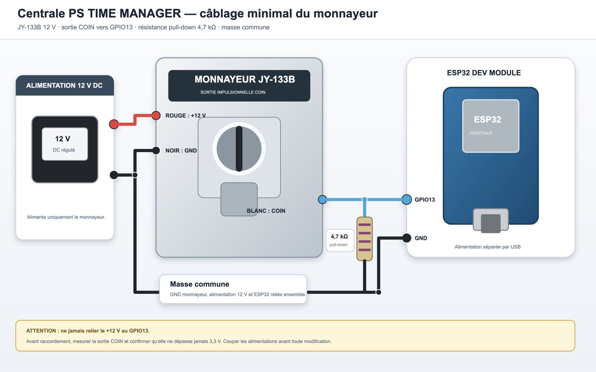
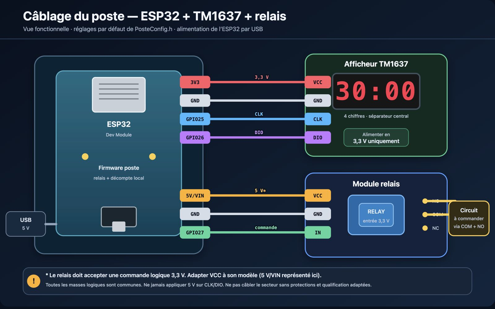

# Guide technique d’installation


Installez et configurez PS TIME MANAGER, de la préparation d’Arduino IDE au premier démarrage de la centrale et des postes. Les noms de postes, comptes, réseaux et montants des illustrations sont des exemples : remplacez-les par les valeurs de votre installation.

## 1. Comprendre le système

La centrale ESP32 reçoit les impulsions du monnayeur, conserve les pièces disponibles et la recette, puis distribue du temps depuis son interface web. Chaque poste possède son propre ESP32, un relais et un afficheur TM1637. Les appareils communiquent sur le même réseau local.

| Élément | Rôle | Accès |
|---|---|---|
| Centrale | Comptes, tarifs, pièces, recettes et commandes des postes | Navigateur : http://pstm.local ou IP centrale |
| Poste | Décompte, relais, afficheur et annonce à la centrale | Pilotage depuis la centrale ; état local /status |
| Monnayeur | Impulsions électriques vers GPIO13 | Valeur et devise réglées dans la centrale |
| Routeur Wi-Fi | Relie les appareils et les navigateurs | Réseau 2,4 GHz, échanges entre clients et mDNS autorisés |

Suivre les étapes dans l’ordre : outils, firmwares, câblage, Wi-Fi, association des postes et vérification de fonctionnement. Le tarif d’un poste reste enregistré dans la centrale ; le poste reçoit une durée de jeu.


## 2. Préparer le matériel et les fichiers

**Prérequis :** disposer des cartes, de leurs alimentations et d’un ordinateur avec accès à Internet pour installer les outils.

1. Préparer un ESP32 Dev Module classique avec 4 Mo de flash pour la centrale et un ESP32 par poste. Les options de ce guide concernent cette famille de carte.
2. Préparer un câble USB de données pour chaque téléversement ; un câble limité à la recharge ne permet pas la programmation.
3. Préparer le monnayeur, son alimentation adaptée, un relais compatible avec la commande 3,3 V et un afficheur TM1637 quatre broches par poste.
4. Préparer un multimètre, des fils isolés et les protections adaptées aux alimentations et aux charges.
5. Copier l’ensemble du projet dans un dossier de travail. Conserver les sous-dossiers et les noms des fichiers.
6. Vérifier la présence des deux ensembles ci-dessous. Ne pas copier seulement le fichier `.ino` : il utilise les fichiers voisins.

| Dossier | Fichier à ouvrir | Fichiers indispensables autour du sketch |
|---|---|---|
| central-esp32 | central-esp32.ino | Services .cpp/.h, assets .inc et partitions.csv |
| poste-esp32 | poste-esp32.ino | Services .cpp/.h et PosteConfig.h |

**Résultat attendu :** les deux sketches complets sont disponibles, les périphériques et la charge restent débranchés pendant la préparation logicielle.

## 3. Télécharger et installer Arduino IDE

**Prérequis :** connaître le système et l’architecture de l’ordinateur. Utiliser Arduino IDE 2 ; la configuration de référence du projet utilise Arduino IDE 2.3.10.

1. Ouvrir la [page officielle de téléchargement Arduino](https://www.arduino.cc/en/software).
2. Choisir l’installateur Arduino IDE 2 adapté à Windows, macOS ou Linux et à l’architecture proposée pour votre ordinateur.
3. Sous Windows, exécuter l’installateur et terminer l’assistant.
4. Sous macOS, ouvrir le téléchargement puis placer Arduino IDE dans **Applications**.
5. Sous Linux, rendre l’AppImage exécutable dans ses propriétés, puis l’ouvrir. Si FUSE manque, suivre les instructions de la distribution indiquées par Arduino.
6. Lancer Arduino IDE et attendre l’ouverture de l’éditeur.

**Résultat attendu :** une fenêtre Arduino IDE affiche un sketch et les outils de compilation. L’installation de l’IDE seule n’ajoute pas le support ESP32.

Référence : [installation d’Arduino IDE 2](https://docs.arduino.cc/software/ide-v2/tutorials/getting-started/ide-v2-downloading-and-installing).

## 4. Repérer les outils d’Arduino IDE

**Prérequis :** Arduino IDE est ouvert. Les noms anglais ci-dessous permettent aussi de retrouver les commandes lorsque l’interface est traduite.

1. Repérer **Vérifier / Verify**, la coche : elle compile le sketch sans programmer la carte.
2. Repérer **Téléverser / Upload**, la flèche : elle compile puis écrit le programme sur la carte sélectionnée.
3. Repérer le sélecteur de carte et de port en haut de la fenêtre, ainsi que **Outils / Tools** dans la barre de menus.
4. Repérer le **Gestionnaire de cartes / Boards Manager** dans la barre latérale.
5. Repérer le **Gestionnaire de bibliothèques / Library Manager**, également dans la barre latérale.
6. Ouvrir les préférences : **Fichier > Préférences / File > Preferences** sous Windows/Linux, ou **Arduino IDE > Réglages / Settings** sous macOS.
7. Si nécessaire, choisir une langue d’interface adaptée et valider. Revenir à l’éditeur.

**Résultat attendu :** vous savez distinguer l’installation du paquet ESP32, celle d’une bibliothèque et le choix de la carte à programmer.

## 5. Ajouter l’URL du support ESP32

**Prérequis :** Arduino IDE installé et connexion Internet disponible.

1. Ouvrir **Fichier > Préférences** sous Windows/Linux, ou **Arduino IDE > Settings** sous macOS.
2. Rechercher **URL de gestionnaire de cartes supplémentaires / Additional boards manager URLs**.
3. Ouvrir le bouton à droite du champ et ajouter l’URL stable ci-dessous sur une ligne. Conserver les autres URL déjà nécessaires à vos projets.
4. Cliquer sur **OK** pour fermer la liste, puis sur **OK** pour enregistrer les préférences.

```text
https://espressif.github.io/arduino-esp32/package_esp32_index.json
```

**Résultat attendu :** le gestionnaire de cartes peut proposer le paquet ESP32 d’Espressif. En cas d’erreur de téléchargement, vérifier l’URL et la connexion avant de poursuivre.

Références : [URL supplémentaires dans Arduino IDE](https://support.arduino.cc/hc/en-us/articles/360016466340-Add-third-party-platforms-to-the-Boards-Manager-in-Arduino-IDE) et [installation du support Espressif](https://docs.espressif.com/projects/arduino-esp32/en/latest/installing.html).

## 6. Installer le paquet de cartes ESP32

**Prérequis :** l’URL Espressif est enregistrée.

1. Ouvrir **Outils > Type de carte > Gestionnaire de cartes / Tools > Board > Boards Manager**, ou son icône latérale.
2. Rechercher `esp32`.
3. Sélectionner **esp32 by Espressif Systems**, et non un paquet destiné à une autre famille de cartes.
4. Choisir la version **3.3.12**, référence utilisée par la configuration du projet, puis **Installer / Install**.
5. Attendre la fin du téléchargement et de l’installation.
6. Revenir à **Outils > Type de carte > esp32** et vérifier que **ESP32 Dev Module** est proposé. Redémarrer l’IDE si nécessaire.

**Résultat attendu :** le paquet affiche son état installé et la carte ESP32 Dev Module est sélectionnable. Ce paquet fournit notamment Wi-Fi, serveur HTTP, Preferences, LittleFS et FreeRTOS.

Référence : [gestionnaire de cartes Arduino](https://support.arduino.cc/hc/en-us/articles/360016119519-Add-boards-to-Arduino-IDE).

## 7. Installer les bibliothèques nécessaires

**Prérequis :** Arduino IDE et le paquet ESP32 sont installés.

1. Ouvrir **Outils > Gérer les bibliothèques / Tools > Manage Libraries**, ou l’icône **Library Manager**.
2. Rechercher `ArduinoJson` et sélectionner **ArduinoJson** de Benoît Blanchon.
3. Choisir **7.4.3**, puis **Installer / Install**.
4. Attendre l’état installé et fermer le gestionnaire.
5. Ne pas installer séparément des bibliothèques homonymes à `WiFi`, `WebServer`, `Preferences`, `ESPmDNS`, `HTTPClient` ou `LittleFS` : utiliser celles fournies par le paquet ESP32.
6. Ne pas ajouter de bibliothèque TM1637 : le pilote du poste se trouve déjà dans `DisplayService.cpp`.

| Dépendance | Centrale | Poste | Installation |
|---|---|---|---|
| esp32 by Espressif Systems 3.3.12 | Oui | Oui | Gestionnaire de cartes |
| ArduinoJson 7.4.3 | Oui | Oui | Gestionnaire de bibliothèques |
| Bibliothèques réseau et stockage ESP32 | Oui | Oui, selon service | Fournies par le paquet de cartes |
| Pilote TM1637 | Non | Oui | Inclus dans le projet |

**Résultat attendu :** les deux sketches peuvent trouver `ArduinoJson.h` et les bibliothèques du cœur ESP32.

Référence : [installer ArduinoJson 7](https://arduinojson.org/v7/how-to/install-arduinojson/).

## 8. Ouvrir les deux sketches

**Prérequis :** les dossiers complets du projet sont copiés sur l’ordinateur.

1. Dans **Fichier > Ouvrir / File > Open**, sélectionner `central-esp32/central-esp32.ino`.
2. Vérifier que les fichiers voisins sont présents dans le dossier et que `partitions.csv` reste à côté du sketch central.
3. Ouvrir ensuite `poste-esp32/poste-esp32.ino` dans une autre fenêtre Arduino IDE.
4. Utiliser le titre de la fenêtre pour distinguer la centrale et le poste avant toute modification ou tout téléversement.
5. Enregistrer les fichiers avec **Fichier > Enregistrer / File > Save** après chaque changement de configuration.

**Résultat attendu :** une fenêtre contient le firmware central et une autre le firmware poste. Chaque fenêtre doit recevoir son propre port et ses options de compilation.

## 9. Brancher une carte et identifier son port

**Prérequis :** la charge commandée est débranchée. Pour identifier facilement les cartes, les connecter une par une.

1. Brancher la centrale en USB avec le câble de données.
2. Dans **Outils > Type de carte > esp32**, sélectionner **ESP32 Dev Module**.
3. Dans **Outils > Port / Tools > Port**, sélectionner le port qui apparaît lors du branchement : par exemple `COM3` sous Windows, `/dev/cu.usbserial-...` sous macOS ou `/dev/ttyUSB...` sous Linux.
4. En cas de doute, débrancher puis rebrancher uniquement cette carte et comparer la liste des ports.
5. Étiqueter la carte « Centrale ». Répéter l’identification pour les postes et noter leur port pendant la programmation.
6. Si aucun port n’apparaît, essayer un autre câble de données et vérifier le pilote du convertisseur USB-série réellement monté sur la carte. Utiliser le pilote du fabricant de ce composant si nécessaire.

**Résultat attendu :** la carte et le port de la fenêtre correspondent au bon ESP32. Un nom de port ne suffit pas à distinguer définitivement deux cartes lorsque les branchements changent.

## 10. Définir le secret commun et les accès initiaux

**Prérequis :** les deux sketches sont ouverts. Choisir une valeur confidentielle commune d’au moins 16 caractères.

1. Dans la fenêtre centrale, ouvrir `AppConfig.h` et remplacer la valeur de `POSTE_COMMAND_TOKEN` par votre secret.
2. Dans la fenêtre poste, ouvrir `PosteConfig.h` et donner exactement la même valeur à `COMMAND_TOKEN`.
3. Répéter ce réglage sur le firmware utilisé pour tous les postes de cette centrale.
4. Dans `AppConfig.h`, vérifier `DEFAULT_ADMIN_USERNAME` et `DEFAULT_ADMIN_PASSWORD`. Par défaut, une installation neuve utilise `admin` et `12345678` ; changer le mot de passe dans l’interface après la première connexion.
5. Si les points d’accès de configuration doivent être protégés, définir `AP_PASSWORD` côté centrale et `WIFI_SETUP_AP_PASSWORD` côté poste avec au moins huit caractères.
6. Enregistrer les fichiers. Ne pas modifier `MDNS_HOSTNAME` et `CENTRAL_MDNS_HOSTNAME` indépendamment : ils doivent désigner la même centrale, `pstm` par défaut.

**Résultat attendu :** la centrale et tous ses postes disposent du même secret de communication. Un changement de ce secret exige de recompiler et téléverser les deux types de firmware.

Le **token API** de l’interface est un autre secret : sa régénération ne modifie pas `COMMAND_TOKEN`. Les valeurs initiales de compte ne remplacent pas automatiquement un compte déjà sauvegardé en NVS.

## 11. Configurer la centrale dans Arduino IDE

**Prérequis :** fenêtre `central-esp32` active, carte classique 4 Mo et port de la centrale identifiés.

1. Sélectionner **Outils > Type de carte > esp32 > ESP32 Dev Module**.
2. Ouvrir les sous-menus **Outils / Tools** et appliquer les valeurs du tableau.
3. Dans **Partition Scheme**, choisir **Minimal SPIFFS**, profil `min_spiffs`. Le suffixe du libellé peut varier selon la version du paquet.
4. Vérifier à nouveau que `central-esp32/partitions.csv` est présent à côté du `.ino`.
5. Dans `AppConfig.h`, conserver `COIN_PIN = 13` si le câblage suit ce guide, le port HTTP 80 et le nom mDNS `pstm`.
6. Enregistrer et vérifier le port USB avant de compiler.

| Menu Outils | Valeur centrale |
|---|---|
| Board | ESP32 Dev Module |
| Flash Size | 4MB (32Mb) |
| CPU Frequency | 240 MHz (WiFi/BT) |
| Flash Frequency | 80 MHz |
| Flash Mode | QIO |
| PSRAM | Disabled |
| Partition Scheme | Minimal SPIFFS / min_spiffs |
| Erase All Flash Before Sketch Upload | Disabled |
| Upload Speed | 460800 ; réduire à 115200 si la liaison est instable |

**Résultat attendu :** le sketch utilise la table locale : deux applications de 1 703 936 octets et une partition LittleFS de 640 Kio. Le schéma standard annoncé par le menu est remplacé par `partitions.csv`. Ne pas sélectionner le profil `default` pour la centrale.

Référence des menus : [options Arduino ESP32](https://docs.espressif.com/projects/arduino-esp32/en/latest/guides/tools_menu.html).

## 12. Compiler et téléverser la centrale

**Prérequis :** secret, carte, port et partitions configurés ; monnayeur et charge débranchés pour la programmation initiale.

1. Cliquer sur **Vérifier / Verify**, ou **Croquis > Vérifier/Compiler / Sketch > Verify/Compile**.
2. Attendre la fin. En cas d’erreur, lire le premier message utile : bibliothèque absente, mauvaise carte ou fichier manquant.
3. Vérifier que la taille du programme ne dépasse pas **1 703 936 octets**, même si le menu de carte affiche une capacité plus grande.
4. Cliquer sur **Téléverser / Upload**, ou **Croquis > Téléverser / Sketch > Upload**.
5. Attendre la fin de l’écriture sans débrancher la carte. Si la connexion au chargeur bloque, utiliser le bouton **BOOT** selon le DevKit, puis relâcher lorsque le transfert commence.
6. Ouvrir **Outils > Moniteur série / Tools > Serial Monitor** et sélectionner **115200 bauds**.
7. Si nécessaire, appuyer sur **EN/RESET** pour relire le démarrage. Repérer la connexion Wi-Fi, l’IP ou le nom du point d’accès de configuration.

**Résultat attendu :** la console ne signale plus d’erreur de téléversement et la carte démarre avec une adresse réseau ou un portail de configuration. Ne pas effacer toute la flash pour corriger une erreur de compilation.

## 13. Configurer un poste dans Arduino IDE

**Prérequis :** fenêtre `poste-esp32` active, port du poste identifié et secret commun enregistré.

1. Choisir **ESP32 Dev Module** et **Outils > Port** correspondant au poste.
2. Appliquer les mêmes options CPU, flash, PSRAM et effacement que pour la centrale, sauf **Partition Scheme**.
3. Pour le poste, sélectionner **Default 4MB with spiffs (1.2MB APP/1.5MB SPIFFS)**, profil `default`.
4. Ouvrir `PosteConfig.h` et vérifier les broches du tableau ci-dessous.
5. Conserver `WIFI_SSID = "YOUR_WIFI"` et `WIFI_PASSWORD = "YOUR_PASSWORD"` pour réaliser la mise en réseau par portail. Un réseau enregistré en NVS reste prioritaire ; ces valeurs ne réinitialisent pas un ancien réseau.
6. Laisser les identifiants `DEFAULT_POST_ID` et `DEFAULT_POST_NAME` vides pour un poste neuf. Le nom et le tarif se définissent dans la centrale.
7. Enregistrer la configuration.

| Constante | Valeur du montage décrit | Usage |
|---|---|---|
| RELAY_PIN | 27 | Commande du relais |
| RELAY_ACTIVE_HIGH | true | Sortie HIGH pour activer le module compatible |
| TM1637_CLK_PIN | 25 | Horloge de l’afficheur |
| TM1637_DIO_PIN | 26 | Données de l’afficheur |
| TM1637_BRIGHTNESS | 5 | Luminosité, plage autorisée 0 à 7 |
| CENTRAL_MDNS_HOSTNAME | pstm | Centrale recherchée sur le LAN |

**Résultat attendu :** le firmware correspond au câblage et utilise la partition du poste. Une polarité différente du relais exige d’adapter `RELAY_ACTIVE_HIGH` au module réel.

## 14. Compiler et téléverser chaque poste

**Prérequis :** configuration du poste enregistrée et charge débranchée des contacts du relais.

1. Cliquer sur **Vérifier / Verify** dans la fenêtre poste.
2. Corriger toute erreur avant de poursuivre. Avec le profil `default`, respecter la capacité applicative de **1 310 720 octets**.
3. Vérifier le port sélectionné, puis cliquer sur **Téléverser / Upload**.
4. Attendre la fin du transfert ; utiliser BOOT si le DevKit l’exige pour entrer dans le chargeur.
5. Ouvrir le moniteur série à **115200 bauds** et repérer l’identité matérielle, le réseau et les éventuelles erreurs de démarrage.
6. Éteindre la carte avant de raccorder les périphériques.
7. Répéter ces opérations pour chaque poste en conservant le secret commun et en vérifiant le port à chaque fois.

**Résultat attendu :** chaque carte démarre avec le firmware poste. Après câblage, un poste sans session doit garder son relais OFF et afficher `00:00`. Un poste ayant une session sauvegardée peut proposer une reprise.

## 15. Câbler la centrale et le monnayeur

**Prérequis :** toutes les alimentations sont coupées. Vérifier le brochage réel du monnayeur et du DevKit au multimètre ; les couleurs de fils peuvent varier.

1. Alimenter le monnayeur selon ses caractéristiques, généralement en 12 V pour le modèle décrit. Alimenter l’ESP32 séparément par USB.
2. Pour une liaison non isolée, relier la masse du monnayeur à GND de l’ESP32.
3. Vérifier que la sortie COIN convient à une entrée 0-3,3 V active LOW. Une sortie 5 V ou 12 V exige une interface d’adaptation avant l’ESP32.
4. Relier la sortie COIN adaptée au **GPIO13**.
5. Utiliser le pull-up interne activé par `INPUT_PULLUP` : repos HIGH, impulsion LOW. Ne pas installer de résistance pull-down entre GPIO13 et GND ; retirer hors tension un ancien pull-down de 2 kΩ ou 4,7 kΩ.
6. Contrôler la continuité et l’absence de liaison entre +12 V et le GPIO13 avant remise sous tension.
7. Mettre sous tension puis attendre le log **Monnayeur prêt** avant d’introduire une pièce. Les cinq premières secondes sont ignorées et l’entrée doit revenir au repos HIGH.

**Résultat attendu :** une impulsion compatible est comptée une fois, puis finalisée en crédit et en recette. L’anti-doublon de 320 ms peut filtrer un train d’impulsions trop rapprochées ; mesurer le signal avant de modifier cette constante.

Le réglage NO est conseillé pour ce fonctionnement, mais ne garantit pas à lui seul le type électrique de la sortie. Ne jamais appliquer directement 5 V ou 12 V au GPIO13.



## 16. Câbler le relais et le TM1637 d’un poste

**Prérequis :** alimentation coupée, charge débranchée et module relais compatible avec une commande 3,3 V. Respecter l’alimentation propre au module relais.

1. Relier GPIO27 à l’entrée de commande du relais et raccorder les masses conformément au module utilisé.
2. Relier GPIO25 à **CLK** du TM1637 et GPIO26 à **DIO**.
3. Relier **3V3** à **VCC** du TM1637 et **GND** à **GND** de l’afficheur.
4. Vérifier que les broches de `PosteConfig.h` correspondent à ces liaisons et qu’elles sont toutes distinctes.
5. Alimenter le poste sans charge sur les contacts. Vérifier relais OFF au repos et affichage `00:00`, ou un temps clignotant en reprise.
6. Après association dans la centrale, attribuer une durée et vérifier la commande du relais et le décompte.
7. Faire raccorder la charge avec un relais dimensionné et les protections nécessaires. Les travaux sur secteur doivent être réalisés par une personne compétente.

**Résultat attendu :** le relais suit la session et le TM1637 affiche `MM:SS` sous une heure, puis `HH:MM`, limité visuellement à `99:59`. La coupure du relais dépend du contrôle local du poste, pas de l’ouverture du navigateur.



## 17. Connecter la centrale au Wi-Fi

**Prérequis :** centrale programmée, réseau Wi-Fi 2,4 GHz et ses identifiants disponibles.

1. Mettre la centrale sous tension. Si elle ne rejoint pas un réseau enregistré après environ 15 secondes, repérer `GAMEROOM-CENTRAL-<chipId>` dans la liste Wi-Fi de l’ordinateur ou du téléphone.
2. Rejoindre ce point d’accès avec le mot de passe configuré, ou sans mot de passe si la valeur par défaut est restée vide.
3. Ouvrir `http://192.168.4.1` si le portail ne s’affiche pas automatiquement.
4. Cliquer sur le réseau local voulu, ou saisir **SSID** manuellement. Renseigner **Mot de passe**.
5. Conserver **Automatique (DHCP)**, ou choisir **Manuelle (IP fixe)** et renseigner IP libre, passerelle et masque ; les DNS sont facultatifs.
6. Cliquer sur **Enregistrer et connecter**. En cas d’échec, corriger les paramètres et recommencer.
7. Après succès, noter l’IP, attendre le redémarrage de la centrale et reconnecter l’ordinateur au réseau local.
8. Ouvrir `http://pstm.local` ou directement l’IP de la centrale.

**Résultat attendu :** la page de connexion de PS TIME MANAGER est accessible depuis le LAN.


## 18. Connecter chaque poste au même réseau

**Prérequis :** centrale accessible sur le LAN et poste programmé avec le même secret de communication.

1. Mettre le poste sous tension. S’il ne rejoint pas un réseau enregistré, se connecter à `GAMEROOM-POSTE-<chipId>`.
2. Ouvrir `http://192.168.4.1`, sélectionner le même réseau local que la centrale et saisir son mot de passe.
3. Choisir DHCP ou IP fixe. En mode manuel, fournir une adresse libre propre à ce poste, la passerelle et le masque, puis les DNS si nécessaires.
4. Cliquer sur **Enregistrer et connecter** et attendre le résultat. Après succès, noter l’IP du poste.
5. Reconnecter le navigateur au LAN et ouvrir la centrale.
6. Vérifier l’apparition du poste dans **Gestion des postes > Postes découverts**.
7. Répéter pour chaque poste, sans réutiliser une même IP fixe.

**Résultat attendu :** chaque poste annonce son identité à la centrale. `http://IP_DU_POSTE/` affiche `Poste OK` ; `/status` renvoie l’état JSON. Les sessions se commandent depuis la centrale.


## 19. Sécuriser le premier accès et associer les postes

**Prérequis :** centrale et postes sur le même LAN ; compte administrateur disponible.

1. Ouvrir la centrale et se connecter. Sur une installation neuve non personnalisée, utiliser `admin` et `12345678`.
2. Dans **Sécurité**, saisir un nouveau mot de passe d’au moins six caractères et le confirmer. Cliquer sur **Changer le mot de passe**, puis se reconnecter si demandé.
3. Ouvrir **Gestion des postes** et repérer l’IP et l’identifiant matériel de la carte à associer.
4. Saisir **Nom du poste** et **Nombre de pièces requis**, entier positif, puis cliquer sur **Ajouter ce poste**.
5. Vérifier sa présence dans **Postes configurés**. Utiliser **Ping** pour contrôler la réponse réseau.
6. Dans **Configuration**, choisir la durée commune, la devise et la valeur d’une impulsion correspondant au monnayeur. Choisir une seule devise par session de caisse : TND ou DZD. Les valeurs DZD proposées par impulsion sont 5, 10, 20, 50, 100, 200 et 500 DA. La valeur 500 DA est enregistrée sous forme de 50 000 centimes et doit correspondre à la programmation du dispositif d’encaissement.
7. Enregistrer, créer les comptes d’exploitation dans **Utilisateurs**, puis exporter une sauvegarde JSON depuis **Configuration**.

**Résultat attendu :** les postes portent leurs noms et tarifs, les comptes ont les bons rôles et les réglages monétaires correspondent au matériel.


## 20. Vérifier le fonctionnement initial

**Prérequis :** montage contrôlé, réseau opérationnel, paramètres enregistrés et accès administrateur. Effectuer les premiers essais sans charge dangereuse.

1. Vérifier le démarrage de chaque poste : relais OFF au repos et affichage cohérent.
2. Dans **Journal**, attendre **Monnayeur prêt**, puis introduire une pièce programmée et comparer le nombre d’impulsions attendues au solde et aux messages.
3. Sur **Vue des postes**, cliquer sur **+N** du bon poste. Vérifier le débit de N pièces et l’ajout d’une durée commune, indépendamment du tarif N.
4. Pendant la session, attribuer une nouvelle durée et constater la prolongation du temps.
5. Cliquer sur **Arrêter la session**, confirmer et vérifier relais OFF et temps à zéro. Un arrêt ne rembourse pas le solde.
6. Laisser aussi une session arriver à expiration pour vérifier la coupure automatique du poste.
7. Ouvrir **Recette**, choisir une période et sélectionner la session de caisse et vérifier sa devise, le total de période, le total de session et l’état de l’horloge. Exporter le rapport utile.
8. Vérifier le compte utilisateur simple : sessions accessibles, modules administrateur absents.
9. Préparer une vérification encadrée de reprise après coupure : relais OFF au redémarrage, puis décision **Reprendre** ou **Annuler** dans la centrale.

**Résultat attendu :** les actions demandées correspondent aux états observés sur la centrale, les relais et les afficheurs. Consulter le [manuel d’utilisation](manuel-utilisation.md) pour les procédures détaillées de chaque fonction.

## 21. Sauvegarder et mettre à jour une installation

**Prérequis :** administrateur disponible ; prévoir une période de maintenance et conserver les accès nécessaires au redémarrage.

1. Dans **Configuration**, cliquer sur **Exporter JSON** et conserver le fichier dans un emplacement protégé.
2. Exporter les rapports financiers utiles. Pour archiver tout l’historique, utiliser le premier stade de **Recette > Mémoire de recette > Exporter et vider la recette**, puis conserver le PDF sans confirmer l’effacement si l’historique doit rester sur la carte. Le JSON ne contient pas `/revenue.bin` ; un rapport agrégé n’est pas non plus une copie brute restaurable de LittleFS.
3. Conserver la table de partitions compatible avec l’installation et laisser **Erase All Flash** désactivé. Un effacement ou changement de partitions peut détruire les données.
4. Si le secret commun change, préparer et programmer la centrale et tous les postes avec la même nouvelle valeur.
5. Compiler et vérifier la taille réelle, sélectionner le bon port puis téléverser en USB.
6. Après redémarrage, vérifier les réglages, tarifs, comptes, réseau et recette avant de reprendre le service.
7. En cas de restauration JSON, utiliser une sauvegarde complète compatible et se reconnecter avec un compte qu’elle contient. Le réseau restauré s’applique au prochain redémarrage.

**Résultat attendu :** le système redémarre avec une configuration cohérente. Une erreur de migration, de CRC ou de stockage exige un diagnostic ; ne pas répondre par un formatage aveugle.

Les sauvegardes V4 conservent durée, solde en pièces, tarifs, devise, valeur d’impulsion, comptes, token API et Wi-Fi/IP. Les V1-V3 sont migrées selon leurs unités. Les comptes contiennent des hashes salés ; le fichier contient aussi des secrets réseau à protéger.

## 22. Comprendre la persistance et les reprises

| Stockage | Données |
|---|---|
| appcfg/configV4 | Durée, devise, valeur d’impulsion et identifiant de session de caisse |
| appcfg/creditsV4 | Solde en pièces et séquence financière locale |
| appcfg/postsV4 | Identités et tarifs des postes |
| appcfg/restoreV4 | Restauration préparée à terminer après redémarrage |
| appcfg/assignmentV4 | Affectation et débit à résoudre en cas d’incertitude |
| auth ; wifi | Comptes, token API et paramètres réseau |
| revenue/pending ; LittleFS /revenue.bin | Préparation d’encaissement et journal financier REV2 |
| Poste : namespace session | Temps sauvegardé et reprise contrôlée |

Le débit d’une attribution est préparé avant la commande au poste et finalisé après succès HTTP. Un timeout peut survenir après exécution de la commande : vérifier le poste avant de répéter. Si le panneau de résolution apparaît, l’administrateur confirme ou annule le débit selon ce constat.

Les encaissements figent la session, la devise et la valeur d’impulsion. Les montants natifs sont stockés en millimes TND ou centimes DZD. La clôture ouvre une nouvelle session à zéro et conserve les anciennes recettes. Une caisse non vide doit être clôturée avant de changer de devise. Sans NTP, les montants restent non datés et exclus des périodes calendaires. Une impulsion encore seulement en RAM n’est pas garantie après disparition de l’alimentation.

Le poste sauvegarde au début de session, après ajout de temps puis toutes les 60 secondes. Après coupure, le relais reste OFF jusqu’à la décision de reprise. Le temps hors tension n’est pas déduit ; la reprise peut restituer environ une minute de plus que le dernier temps réel.

### Capacité et maintenance de la recette

La partition LittleFS fait 640 Kio. Une écriture REV2 occupe 72 octets ; le plafond brut est de l’ordre de 9 000 écritures avant frais du système de fichiers. Une écriture peut représenter plusieurs impulsions. La compaction horaire regroupe les écritures compatibles d’une même session, devise et valeur d’impulsion. Surveiller l’occupation affichée dans Recette plutôt que promettre un nombre fixe de sessions.

Le parcours **Exporter et vider la recette** exporte toutes les sessions puis attend la confirmation que le PDF est enregistré. Le serveur refuse l’effacement si de nouvelles opérations sont apparues, si les pages d’export n’ont pas toutes été lues ou après quinze minutes. La capture du monnayeur est suspendue pendant le remplacement du journal, pas pendant toute la lecture du PDF : réaliser la maintenance au repos.

Seul `/revenue.bin` est remplacé par un journal minimal comportant un repère de séquence. Les autres fichiers LittleFS, les instantanés NVS et les crédits sont conservés. Le fichier temporaire et le fichier de secours rendent le remplacement récupérable ; une erreur de stockage peut imposer un redémarrage et une vérification du journal. Ne pas utiliser un formatage complet comme raccourci.

## 23. Utiliser les API de diagnostic

**Prérequis :** accès au LAN. Les commandes d’écriture vers les postes utilisent le secret partagé des firmwares ; l’API centrale utilise un token distinct ou une session autorisée.

1. Lire `http://IP_DU_POSTE/status` pour connaître identité, IP, relais, temps et reprise.
2. Lire `GET /posts` sur la centrale avec authentification pour connaître tarifs, solde et disponibilité.
3. Pour une intégration, transmettre le token API complet dans `Authorization: Bearer VOTRE_TOKEN_API` ; la valeur masquée de l’interface ne suffit pas.
4. Employer `POST /assign` avec `post_id` pour une seule durée ; le serveur retrouve le tarif, sans accepter un coût arbitraire fourni par le client.
5. Pour un diagnostic poste sans ajout de temps, envoyer `PING` à `/command` avec le secret inter-ESP32.

```sh
curl http://IP_DU_POSTE/status
curl http://pstm.local/posts \
  -H 'Authorization: Bearer VOTRE_TOKEN_API'
```

| Routes centrales | Fonction et accès |
|---|---|
| /assign ; /stop ; /recovery/resume ; /recovery/cancel | Sessions : utilisateur autorisé ou API |
| /post/update ; /post/delete ; /post/ping ; /poste/configure | Administration des postes |
| /config ; /config/export ; /config/import | Configuration et sauvegarde : admin |
| /assignment/resolve | Résoudre le débit : admin |
| /revenue/data ; /revenue/export.csv | Recette par session, période et devise : admin |
| /revenue/archive/prepare ; /revenue/archive/page ; /revenue/clear | Export complet puis effacement confirmé : admin |
| /users/data ; /users/create ; /users/update ; /users/delete | Comptes : admin |
| /auth/password ; /auth/token/regenerate ; /wifi/reset | Sécurité et réseau : admin ; session requise pour le mot de passe |
| /logs/data ; /logs/clear | Journal : admin |
| /poste/announce | Annonce avec secret inter-ESP32 |

Le poste expose `/configure`, `/identity/clear` et `/command` avec son secret partagé. Les portails exposent `/wifi`, `/wifi/scan` et `/wifi/save` uniquement pendant leur mode de configuration. Il n’existe pas de tableau de bord de session local au poste.

## 24. Dépanner l’installation

| Symptôme | Vérifications | Action |
|---|---|---|
| ESP32 absent du gestionnaire | URL et réseau | Corriger l’URL Espressif, rouvrir le gestionnaire |
| ArduinoJson.h introuvable | Bibliothèque installée et sketch complet | Installer ArduinoJson 7.4.3 ; rouvrir le sketch |
| Aucun port USB | Câble de données, pilote USB-série, permissions du système | Identifier le composant USB et appliquer les instructions de son fabricant |
| Téléversement bloqué | Bon port, carte, moniteur série, câble | Fermer les autres logiciels utilisant le port, essayer BOOT et réduire Upload Speed |
| Programme trop volumineux | Bon sketch et partition | Centrale : min_spiffs + CSV local ; poste : default ; vérifier la limite réelle |
| Portail Wi-Fi absent | Bon SSID de configuration | Ouvrir 192.168.4.1 ; consulter le moniteur série |
| pstm.local inaccessible | Même LAN, mDNS et isolation des clients | Utiliser l’IP centrale et contrôler le routeur |
| Poste hors ligne | Alimentation, secret commun, /status et IP | Tester Ping puis corriger réseau ou firmware |
| Pièces non comptées | Monnayeur prêt, repos HIGH, GPIO13, tension | Contrôler câblage et signal ; retirer l’ancien pull-down hors tension |
| Afficheur ou relais incorrect | Broches, polarité et alimentations | Contrôler sans charge puis adapter PosteConfig.h si nécessaire |
| Débit incertain | Résultat réel sur le poste | Utiliser la résolution administrateur sans répéter aveuglément |
| NVS/LittleFS en erreur | Message exact et espace libre | Conserver les données et diagnostiquer sans formater ; si le journal reste lisible, exporter puis vider uniquement la recette |

**Résultat attendu :** chaque correction répond à un symptôme identifié. Une opération de câblage se réalise hors tension ; une opération de maintenance doit préserver les réglages et l’historique utiles à l’exploitation.
