# Manuel d’utilisation

Utilisez PS TIME MANAGER pour suivre les postes de jeu, attribuer du temps et administrer la salle. Ce manuel distingue les tâches de l’utilisateur simple et celles de l’administrateur. Les postes, réseaux, comptes et montants illustrés sont des exemples ; utilisez les valeurs de votre installation.

## 1. Choisir le parcours correspondant à son rôle

L’utilisateur simple exploite les sessions depuis **Vue des postes**. L’administrateur dispose de ces mêmes fonctions et des modules **Recette**, **Gestion des postes**, **Utilisateurs**, **Sécurité**, **Journal** et **Configuration**.

| Fonction | Utilisateur simple | Administrateur |
|---|---|---|
| Consulter postes, solde, tarifs et temps | Oui | Oui |
| Démarrer, prolonger ou arrêter une session | Oui | Oui |
| Reprendre ou annuler un temps sauvegardé | Oui | Oui |
| Afficher ou masquer les indicateurs | Oui | Oui |
| Simuler une pièce, corriger le solde et régler la durée | Non | Oui |
| Ajouter, modifier et supprimer des postes ou des comptes | Non | Oui |
| Consulter et exporter la recette | Non | Oui |
| Sauvegarde, restauration, sécurité, journal et Wi-Fi centrale | Non | Oui |
| Résoudre un débit interrompu | Non | Oui |

**Pour commencer :** les sections de connexion, de sessions, d’indicateurs, de navigation mobile et de déconnexion concernent les deux rôles. Les procédures marquées **Administrateur** complètent ce parcours. Pour installer les cartes et les logiciels, consulter le [guide technique](guide-technique.md).

## 2. Se connecter à la centrale

**Accès :** utilisateur simple et administrateur. **Prérequis :** être sur le réseau local et disposer d’un compte.

1. Ouvrir `http://pstm.local` ou l’adresse IP de la centrale.
2. Saisir **Nom d’utilisateur** et **Mot de passe**.
3. Utiliser le bouton d’affichage du mot de passe si nécessaire pour vérifier la saisie.
4. Choisir si **Se souvenir de moi** doit rester coché sur cet appareil, puis cliquer sur **Se connecter**.
5. Si la connexion est refusée, corriger la saisie. Un compte utilisateur simple doit demander à un administrateur la réinitialisation de son mot de passe si nécessaire.

**Résultat attendu :** **Vue des postes** s’ouvre et le compte courant apparaît dans le menu. L’administrateur voit les modules de gestion ; l’utilisateur simple voit son parcours d’exploitation.

Sur une installation neuve non personnalisée, le compte initial est `admin` / `12345678`. Le mot de passe doit ensuite être changé par l’administrateur. **Se souvenir de moi** conserve le cookie pendant 30 jours, mais un redémarrage de la centrale impose une nouvelle connexion car les sessions sont en RAM.

## 3. Consulter les postes et les indicateurs

**Accès :** utilisateur simple et administrateur. **Prérequis :** session ouverte sur la centrale.

1. Ouvrir **Vue des postes** dans le menu.
2. Lire les cinq indicateurs : **Pièces disponibles**, **Durée par attribution**, **Postes actifs**, **Postes hors ligne** et **Reprises en attente**.
3. Repérer la carte du poste voulu par son nom et, si nécessaire, son IP.
4. Lire son **Tarif**, son état, son temps restant et l’indication **Relais ON/OFF**.
5. Avant toute commande, vérifier que le poste choisi est le bon. Attendre l’actualisation des valeurs si son état vient de changer.

**Résultat attendu :** vous connaissez le solde partagé, le coût d’une attribution et l’état de chaque poste. Un poste **Hors ligne** est indisponible ; **Reprise en attente** demande une décision avant une nouvelle attribution. L’état général de l’en-tête ne remplace pas l’état individuel des postes.

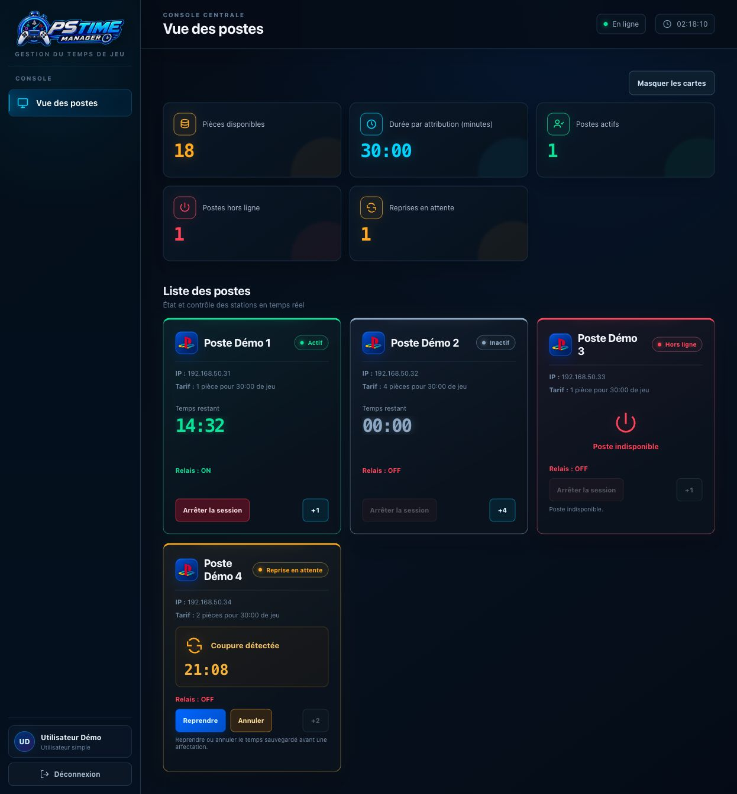

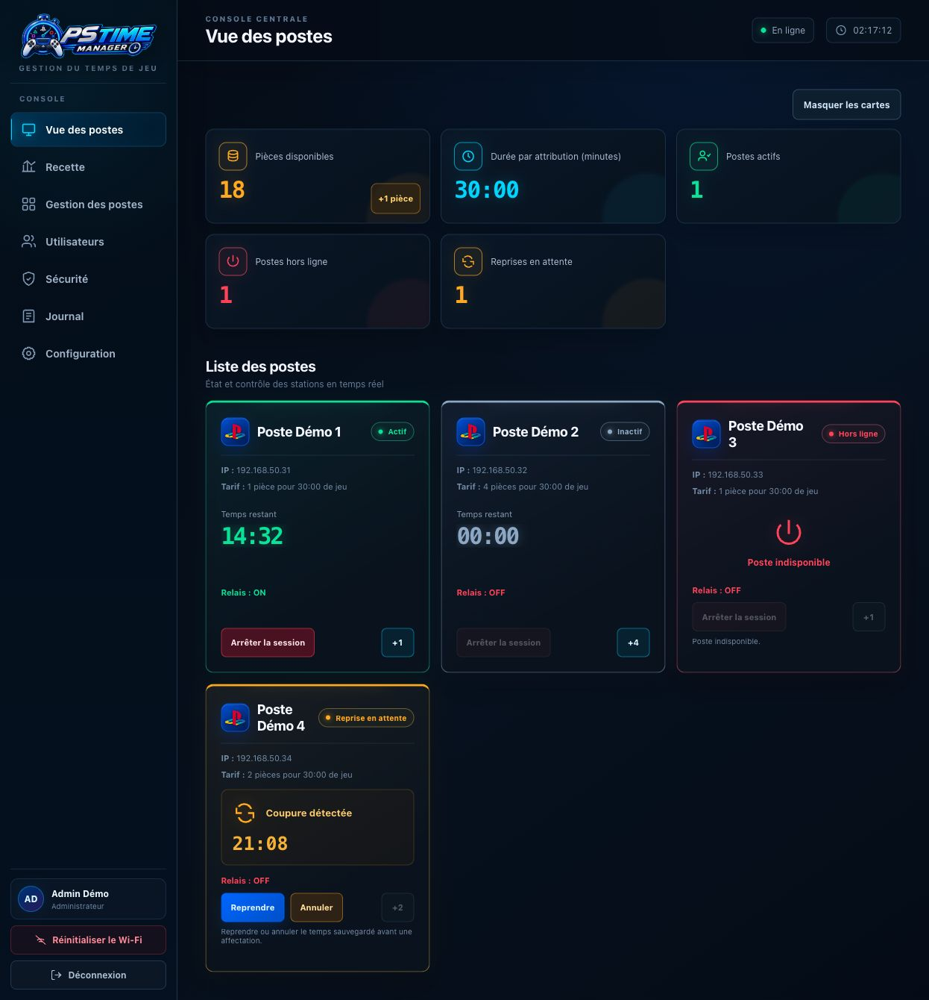

## 4. Masquer ou réafficher les indicateurs

**Accès :** utilisateur simple et administrateur. **Emplacement :** **Vue des postes**.

1. Cliquer sur **Masquer les cartes** pour replier les cinq indicateurs.
2. Continuer à consulter et commander les postes dans la liste affichée.
3. Cliquer sur **Afficher les cartes** pour rétablir les indicateurs.

**Résultat attendu :** seule leur visibilité change. Le solde et les sessions ne sont pas modifiés. Le choix est mémorisé dans le navigateur utilisé.

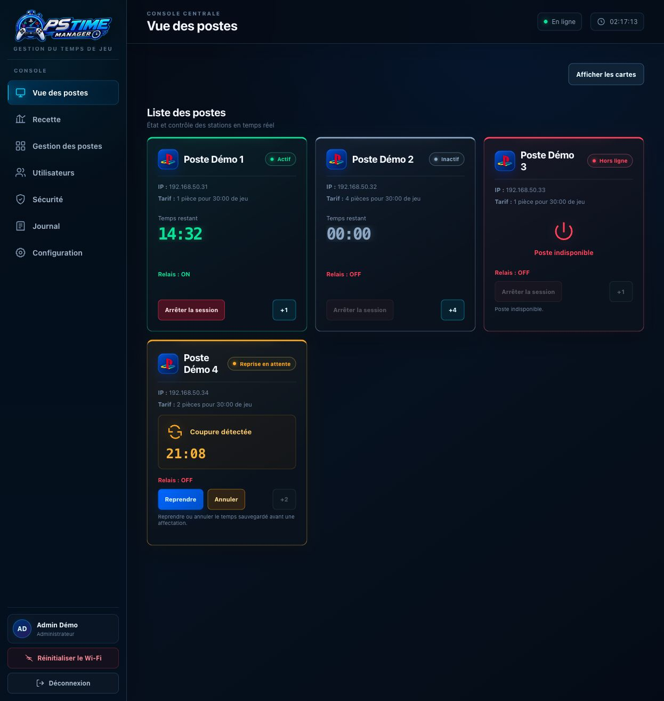

## 5. Démarrer une session de jeu

**Accès :** utilisateur simple et administrateur. **Prérequis :** poste inactif et joignable, solde suffisant, aucune reprise à résoudre et stockage disponible.

1. Ouvrir **Vue des postes** et choisir le poste du client.
2. Lire son tarif et la durée commune. Le bouton **+N** consomme N pièces pour ajouter une seule durée de jeu.
3. Vérifier que le solde contient au moins N pièces.
4. Cliquer une fois sur **+N** et attendre la réponse avant une nouvelle action.
5. Vérifier que la carte devient **Actif**, que le relais est affiché ON et que le temps apparaît. Contrôler le poste et son afficheur si nécessaire.

**Résultat attendu :** le poste démarre et le solde est diminué du tarif. Exemple : avec 18 pièces disponibles, un clic sur **+4** laisse 14 pièces et ajoute 30 minutes si la durée commune vaut 30 minutes.

Si le bouton est désactivé, lire l’explication de la carte : solde insuffisant, poste indisponible, reprise non résolue ou problème de stockage. Après un timeout, vérifier si le poste a reçu le temps avant de recommencer.

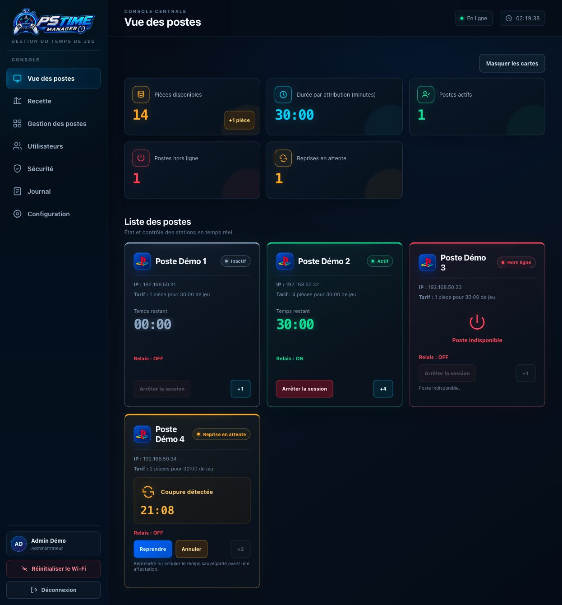

## 6. Prolonger une session active

**Accès :** utilisateur simple et administrateur. **Prérequis :** poste actif et joignable, pièces suffisantes pour son tarif.

1. Sur **Vue des postes**, vérifier le nom et le temps restant du poste actif.
2. Lire le tarif courant : il peut avoir été modifié par l’administrateur depuis le début de la session.
3. Cliquer une fois sur **+N**.
4. Attendre la réponse, puis vérifier l’augmentation du temps restant et la diminution du solde de N pièces.

**Résultat attendu :** une durée commune s’ajoute au temps de la session existante. Le tarif détermine les pièces consommées ; il ne multiplie pas la durée ajoutée. Ne pas enchaîner les clics pour compenser une réponse réseau incertaine.

## 7. Arrêter une session avant son terme

**Accès :** utilisateur simple et administrateur. **Prérequis :** session active, poste joignable et accord pour perdre le temps restant.

1. Dans **Vue des postes**, repérer la carte du poste concerné.
2. Cliquer sur **Arrêter la session**.
3. Lire la confirmation, qui précise que le temps restant sera définitivement perdu.
4. Confirmer pour arrêter, ou annuler la boîte de dialogue pour conserver la session.
5. Après confirmation, vérifier le temps à zéro et le relais OFF. En cas d’erreur réseau, vérifier le poste avant une nouvelle commande.

**Résultat attendu :** la session est interrompue. Les pièces déjà dépensées ne sont pas remboursées. À expiration normale du temps, le poste coupe aussi son relais automatiquement, sans navigateur ouvert.

## 8. Reprendre ou annuler un temps sauvegardé

**Accès :** utilisateur simple et administrateur. **Prérequis :** carte **Reprise en attente** après redémarrage d’un poste.

### Reprendre le temps

1. Repérer la carte marquée **Reprise en attente** et lire le temps récupérable.
2. Vérifier l’identité du poste et la situation du client. Le relais reste OFF dans l’attente d’une décision.
3. Cliquer sur **Reprendre**, puis confirmer la reprise proposée.
4. Vérifier le passage à **Actif**, le relais ON et le temps repris.

**Résultat attendu :** le temps sauvegardé est relancé, sans achat d’une nouvelle durée. Pour ajouter ensuite du temps, utiliser **+N** au tarif normal.

### Annuler le temps

1. Sur la carte concernée, cliquer sur **Annuler**.
2. Lire puis confirmer l’annulation définitive, ou fermer la confirmation pour garder le temps sauvegardé.
3. Vérifier que le poste revient au repos, temps à zéro et relais OFF.

**Résultat attendu :** le temps récupérable est effacé. Le temps hors tension n’est pas déduit de la reprise ; la sauvegarde périodique peut restituer environ une minute de plus que le dernier temps réel.

## 9. Se déconnecter et changer d’opérateur

**Accès :** utilisateur simple et administrateur. **Prérequis :** session web ouverte.

1. Ouvrir le menu si vous êtes sur mobile.
2. Cliquer sur **Déconnexion** dans la partie basse de la barre latérale.
3. Vérifier le retour à la page **Connexion**.
4. Pour changer d’opérateur, se connecter avec le compte de la personne qui reprend le service.

**Résultat attendu :** la session web de cet opérateur est fermée. La déconnexion ne coupe pas les sessions de jeu en cours ; les postes continuent leur décompte local.

## 10. Utiliser l’interface sur téléphone

**Accès :** utilisateur simple et administrateur, selon les droits du compte. **Prérequis :** téléphone connecté au LAN de la centrale.

1. Ouvrir l’IP de la centrale ou `http://pstm.local` et se connecter.
2. Utiliser **Ouvrir le menu** dans l’en-tête pour afficher la navigation.
3. Choisir le module autorisé : **Vue des postes** pour l’exploitation, et les modules supplémentaires pour l’administrateur.
4. Faire défiler pour atteindre les cartes de poste ou la suite d’un formulaire.
5. Effectuer la même procédure que sur ordinateur, puis lire le résultat avant de quitter la page.

**Résultat attendu :** les fonctions sont accessibles dans une disposition adaptée à la largeur de l’écran. Les illustrations suivantes montrent un compte administrateur ; le menu utilisateur simple contient moins d’options.

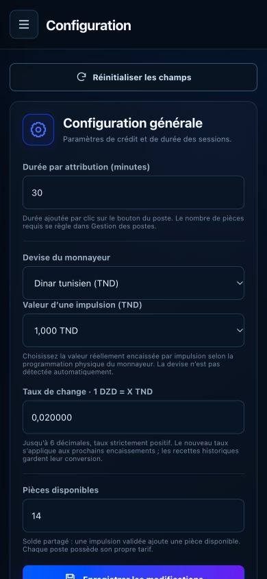

## 11. Administrateur : ajouter un poste découvert

**Prérequis :** poste allumé, connecté au même LAN et configuré avec le secret commun de la centrale.

1. Ouvrir **Gestion des postes**.
2. Dans **Postes découverts**, repérer le poste par son IP et son identifiant matériel. **Actualiser** permet de relire la liste.
3. Saisir **Nom du poste**, par exemple `PS2`.
4. Saisir **Nombre de pièces requis**, entier de 1 à 2 147 483 647. La valeur proposée pour un nouveau poste est 1.
5. Cliquer sur **Ajouter ce poste** et lire le message de résultat.
6. Vérifier sa présence dans **Postes configurés**, puis dans **Vue des postes**.

**Résultat attendu :** le poste possède un nom et un tarif persistants. L’identifiant matériel est repris automatiquement ; il n’est pas à saisir. Une découverte non configurée disparaît après 30 secondes sans annonce ; vérifier le réseau si la carte attendue disparaît.

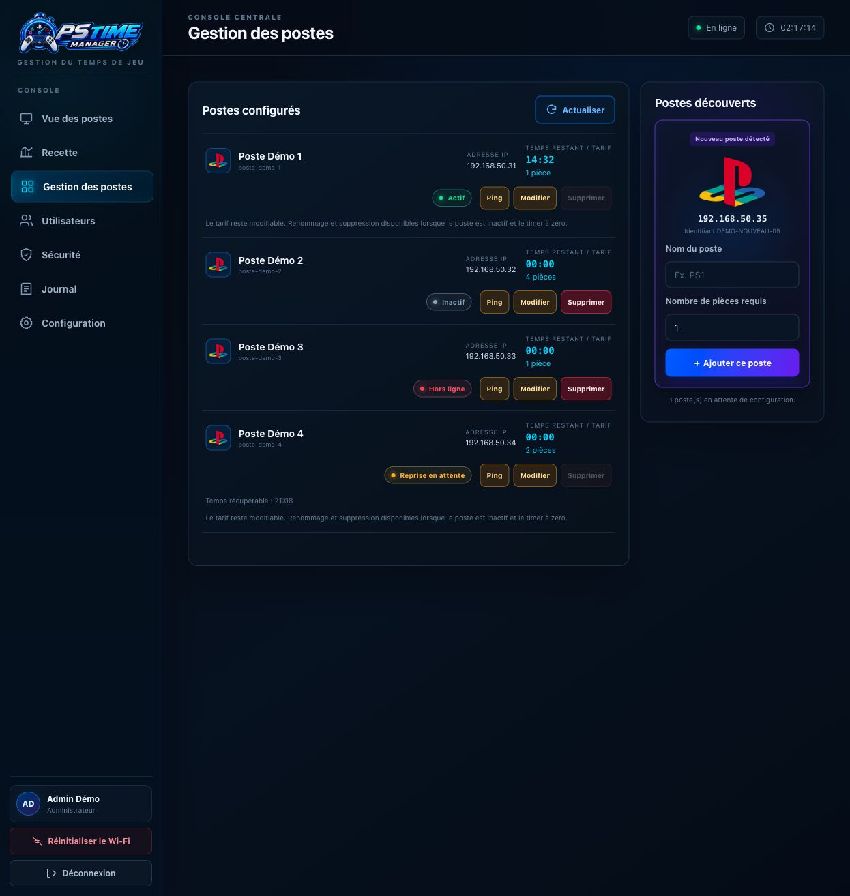

## 12. Administrateur : tester et renommer un poste

**Emplacement :** **Gestion des postes > Postes configurés**.

### Tester la communication

1. Repérer le poste et son IP.
2. Cliquer sur **Ping**.
3. Lire **Ping réussi** ou le message d’échec.
4. En cas d’échec, contrôler alimentation, réseau, IP et secret de communication avant de commander une session.

**Résultat attendu :** vous connaissez la réponse réseau du poste. Un Ping réussi ne vérifie pas physiquement le relais ou l’afficheur.

### Renommer un poste

1. Attendre que le poste soit inactif, temps à zéro, sans reprise en attente.
2. Cliquer sur **Modifier**.
3. Changer **Nom du poste**, en conservant le tarif souhaité.
4. Cliquer sur **Enregistrer modification** et lire le résultat.
5. Vérifier le nouveau nom dans la gestion et sur la carte d’accueil.

**Résultat attendu :** le nom est actualisé. Le champ de nom est bloqué pendant une session ou une reprise.

## 13. Administrateur : modifier le tarif d’un poste

**Prérequis :** poste déjà enregistré. **Emplacement :** **Gestion des postes**.

1. Repérer le poste, puis cliquer sur **Modifier**.
2. Dans **Nombre de pièces requis**, saisir le nouveau tarif entier positif.
3. Conserver le nom actuel si seul le tarif doit changer.
4. Cliquer sur **Enregistrer modification**, puis lire le message.
5. Revenir à **Vue des postes** et vérifier le tarif et le bouton **+N**.

**Résultat attendu :** les prochaines attributions utilisent le nouveau tarif. Le changement n’altère ni le solde, ni le temps déjà acquis. Le tarif peut être modifié pendant une session et hors ligne ; le renommage reste soumis à la disponibilité du poste.

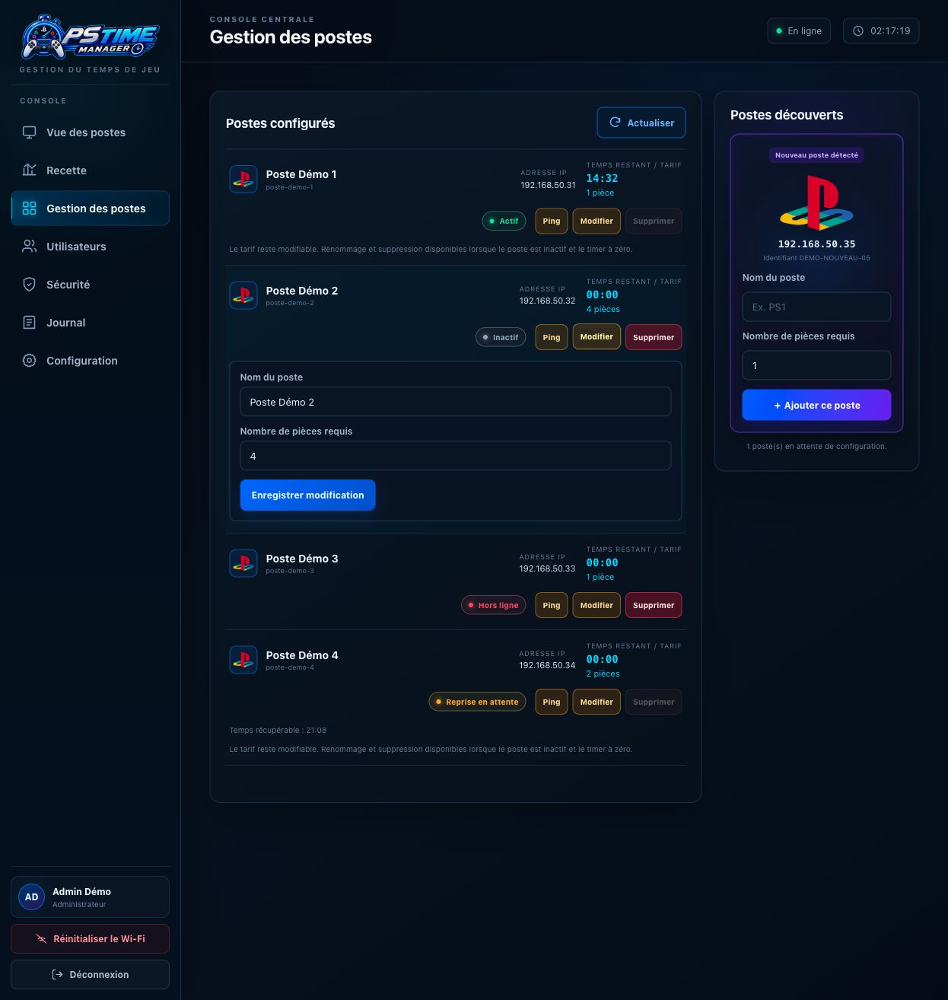

## 14. Administrateur : supprimer un poste

**Prérequis :** aucune session active, temps à zéro et aucune reprise en attente. Un poste hors ligne peut être retiré.

1. Ouvrir **Gestion des postes** et repérer son nom et son IP.
2. Vérifier que **Supprimer** est disponible. Sinon, terminer la session ou traiter la reprise avant de supprimer.
3. Cliquer sur **Supprimer**, puis lire et confirmer le nom présenté.
4. Vérifier que le poste disparaît de la liste configurée.

**Résultat attendu :** le poste est retiré de la centrale. S’il est joignable, la centrale tente aussi d’effacer son identité. Un poste qui conserve son identité et se reconnecte peut réapparaître ; traiter son état réseau avant une nouvelle association.

## 15. Administrateur : régler la durée commune

**Prérequis :** accès à **Configuration**, stockage disponible.

1. Ouvrir **Configuration**.
2. Dans **Durée par attribution (minutes)**, saisir la durée à ajouter par clic, avec un minimum d’une minute.
3. Vérifier les autres champs sans corriger le solde si ce n’est pas nécessaire.
4. Cliquer sur **Enregistrer les modifications**.
5. Lire **Configuration enregistrée**, puis vérifier la durée sur **Vue des postes**.

**Résultat attendu :** les prochaines attributions ajoutent cette durée. Les tarifs restent individuels et se modifient dans **Gestion des postes**. Le réglage ne recalcule pas le temps déjà attribué.

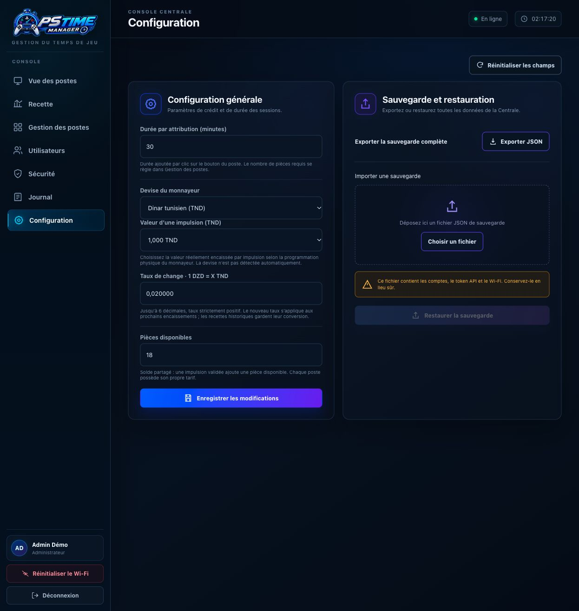

## 16. Administrateur : configurer le monnayeur en TND

**Prérequis :** connaître la valeur financière d’une impulsion selon la programmation physique du monnayeur.

1. Ouvrir **Configuration** et choisir **Dinar tunisien (TND)** dans **Devise du monnayeur**.
2. Choisir **Valeur d’une impulsion (TND)** : 0,500 ; 1 ; 2 ou 5 TND, selon le signal réellement envoyé par le monnayeur.
3. Vérifier la durée et conserver le solde si aucune correction n’est voulue.
4. Si un taux DZD/TND est déjà renseigné et doit être modifié, conserver une valeur positive ; ne pas le remplacer par zéro.
5. Cliquer sur **Enregistrer les modifications** et lire le message de réussite.

**Résultat attendu :** les prochains encaissements utilisent le profil TND choisi. La devise et la valeur ne sont pas détectées automatiquement. Une pièce physique peut produire plusieurs impulsions ; la valeur choisie correspond à une impulsion, pas nécessairement à la pièce entière.

## 17. Administrateur : configurer le DZD et le taux

**Prérequis :** connaître la valeur par impulsion et le taux de conversion à appliquer aux nouveaux encaissements.

1. Ouvrir **Configuration** et sélectionner **Dinar algérien (DZD)**.
2. Choisir la valeur par impulsion : 0,25 ; 0,50 ; 1 ; 2 ; 5 ; 10 ; 20 ; 50 ; 100 ou 200 DZD.
3. Dans **Taux de change · 1 DZD = X TND**, saisir une valeur strictement positive, de 0,000001 à 1000 TND, avec au plus six décimales. Virgule et point sont acceptés.
4. Conserver les autres réglages souhaités, puis cliquer sur **Enregistrer les modifications**.
5. Lire le message de réussite et vérifier le taux affiché dans **Recette**.

**Résultat attendu :** les prochains encaissements DZD conservent leur montant natif et leur conversion TND au taux choisi. Changer le taux ne modifie ni l’historique, ni les tarifs, ni le temps de jeu. Le taux 0,020000 des illustrations est fictif.

## 18. Administrateur : corriger une saisie ou réinitialiser les champs

**Emplacement :** **Configuration**.

### Corriger un refus de validation

1. Cliquer sur **Enregistrer les modifications** et lire le message si la saisie est refusée.
2. Corriger le champ concerné : durée positive, valeur proposée pour la devise, taux valide ou solde entier non négatif.
3. Cliquer à nouveau sur **Enregistrer les modifications**.
4. Attendre un message de réussite ; un message d’erreur ne confirme pas l’enregistrement.

**Résultat attendu :** les paramètres sont enregistrés seulement après validation. En DZD, un taux nul ou vide est refusé.

### Abandonner les modifications non enregistrées

1. Cliquer sur **Réinitialiser les champs**.
2. Vérifier le retour aux dernières valeurs chargées.
3. Choisir à nouveau un fichier de restauration si nécessaire : cette action efface aussi la sélection du fichier JSON dans le navigateur.

**Résultat attendu :** le formulaire est rétabli sans effacer les données de la centrale.

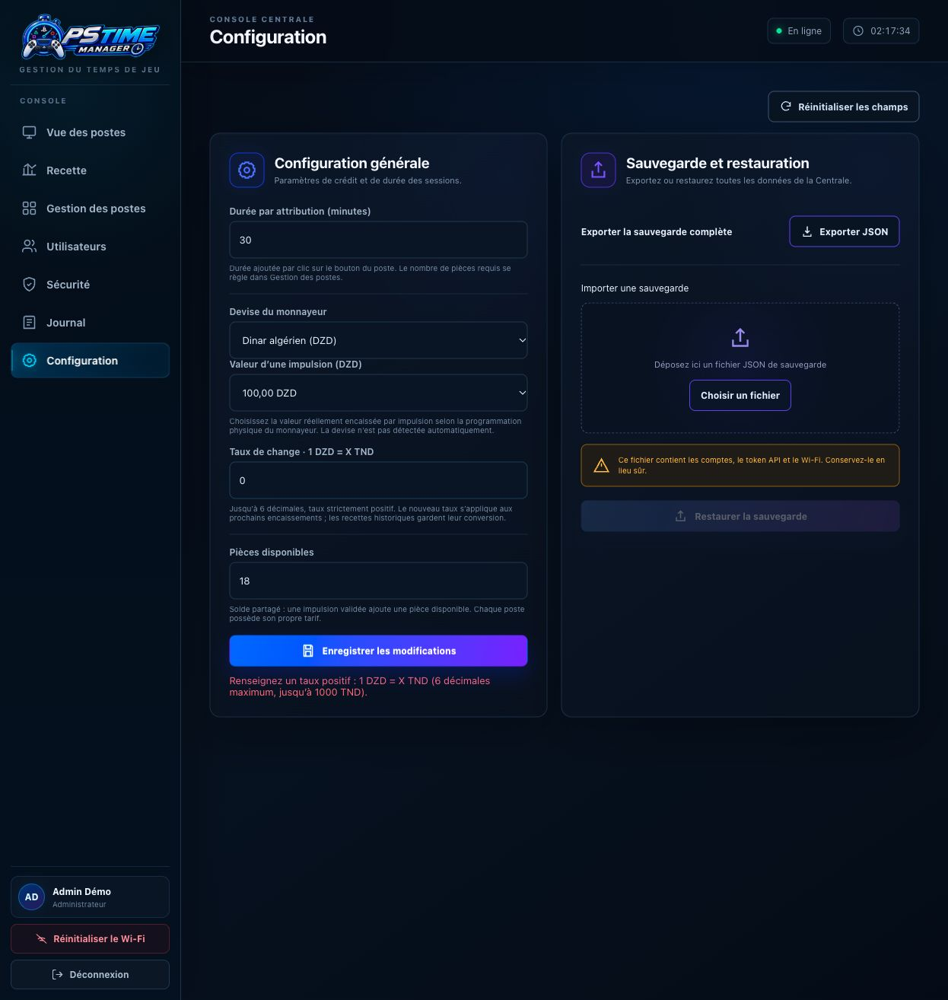

## 19. Administrateur : simuler une pièce

**Prérequis :** stockage et solde disponibles pour l’opération. **Emplacement :** **Vue des postes**.

1. Repérer l’indicateur **Pièces disponibles**.
2. Cliquer une fois sur **+1 pièce**.
3. Attendre l’actualisation et vérifier l’augmentation du solde d’une unité.
4. Utiliser ensuite ce crédit uniquement selon les besoins de l’exploitation ou du diagnostic.

**Résultat attendu :** une pièce disponible est ajoutée, sans créer de recette. Cette fonction ne vérifie pas le signal électrique du monnayeur. Elle n’est pas accessible à l’utilisateur simple.

## 20. Administrateur : corriger le solde partagé

**Prérequis :** connaître le solde final voulu et coordonner la correction avec les autres opérateurs.

1. Ouvrir **Configuration** et lire **Pièces disponibles**.
2. Saisir le solde total voulu, entier de 0 à 2 147 483 647. Le champ remplace le solde ; il ne représente pas un nombre de pièces à ajouter.
3. Vérifier la valeur et les autres paramètres du formulaire.
4. Cliquer sur **Enregistrer les modifications**.
5. Revenir à **Vue des postes** et vérifier le nouveau solde partagé.

**Résultat attendu :** le solde est corrigé sans écriture de recette. Cette action ne change ni les tarifs, ni le temps des sessions en cours.

## 21. Administrateur : exporter une sauvegarde

**Prérequis :** compte administrateur et navigateur autorisant les téléchargements. **Emplacement :** **Configuration > Sauvegarde et restauration**.

1. Cliquer sur **Exporter JSON**.
2. Attendre le message **La sauvegarde complète a été téléchargée**.
3. Vérifier la présence du fichier `.json` dans les téléchargements du navigateur.
4. Conserver le fichier dans un emplacement protégé et identifié pour cette centrale.

**Résultat attendu :** une sauvegarde V4 conserve paramètres, pièces disponibles, tarifs, comptes, token API, Wi-Fi/IP et préférence locale d’affichage des indicateurs.

Le fichier contient des secrets. Il ne contient pas le journal financier LittleFS, les sessions physiques en cours, les postes simplement découverts ou les logs RAM. Exporter séparément les rapports financiers utiles.

## 22. Administrateur : restaurer une sauvegarde

**Prérequis :** sauvegarde complète de la centrale, accès à un compte qu’elle contient et période de maintenance adaptée.

1. Ouvrir **Configuration > Sauvegarde et restauration**.
2. Cliquer sur **Choisir un fichier**, ou déposer la sauvegarde dans la zone prévue.
3. Sélectionner un fichier `.json` de 24 Kio maximum et vérifier le nom affiché. Le JSON doit être valide ; sa syntaxe seule ne garantit pas qu’il s’agit d’une sauvegarde complète.
4. Cliquer sur **Restaurer la sauvegarde**.
5. Lire la confirmation : réglages, comptes, postes et réseau actuels seront remplacés. Confirmer seulement si le fichier est celui voulu.
6. Attendre la réponse, puis se reconnecter avec un compte de la sauvegarde lorsque demandé.
7. Vérifier réglages, tarifs et comptes. Les paramètres réseau restaurés s’appliquent au prochain redémarrage de la centrale.

**Résultat attendu :** la configuration persistante est remplacée et les sessions web sont fermées. Le journal financier LittleFS et les sessions physiques des postes ne sont pas restaurés par ce JSON. En cas d’erreur de stockage, relever le message et suivre le diagnostic avant toute nouvelle opération.

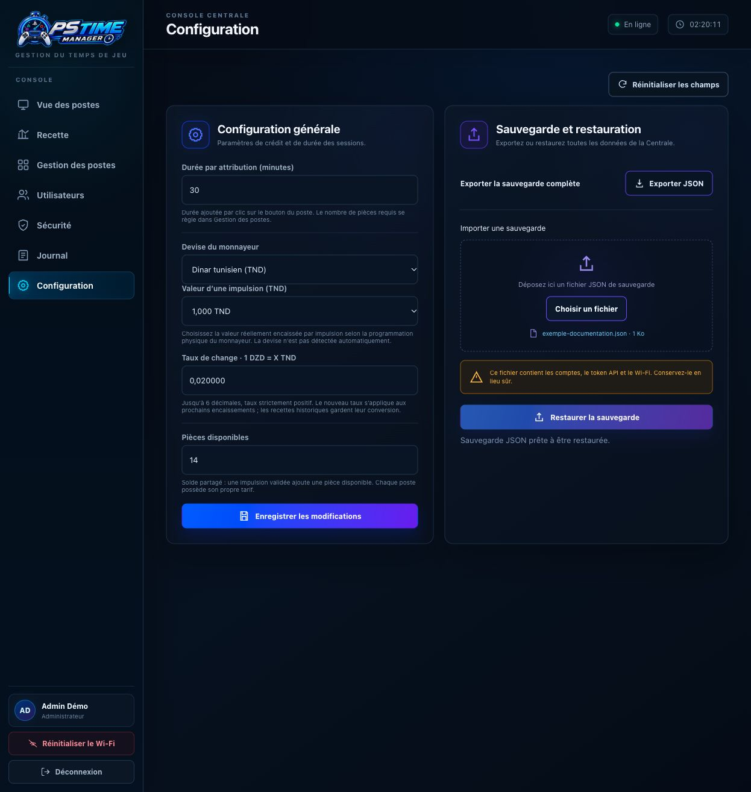

## 23. Administrateur : lire la recette et ses indicateurs

**Prérequis :** accès au module **Recette**.

1. Ouvrir **Recette**.
2. Lire le bandeau de stockage et d’horloge : LittleFS prêt, occupation et éventuelle attente NTP ou erreur.
3. Lire les trois montants : **Total général en TND**, **Total encaissé en TND** et **Total encaissé en DZD**.
4. Lire les compteurs : **Impulsions encaissées**, **Crédits historiques / pièces** et **Écritures persistées**.
5. Consulter le graphique et son tableau **Détail**. Le graphique représente le total TND ; l’infobulle indique les deux montants d’origine.
6. Si des montants sont non datés, vérifier l’horloge ; ils restent signalés séparément et exclus des périodes calendaires.

**Résultat attendu :** vous distinguez l’argent encaissé du solde de pièces encore disponible. Les simulations et corrections du solde sont exclues de la recette. Les conversions utilisent le taux historique de chaque impulsion, arrondi au millime.

## 24. Administrateur : choisir jour, semaine ou mois

**Prérequis :** module **Recette** ouvert.

1. Dans **Regrouper par**, choisir **Jour**, **Semaine** ou **Mois**.
2. Dans **Date de référence**, sélectionner la date voulue.
3. Attendre le chargement ; utiliser **Actualiser** pour relire la même période.
4. Vérifier la plage affichée au-dessus du graphique et du tableau avant de lire les totaux ou d’exporter.
5. Lire le détail par heure en mode Jour, ou par jour en mode Semaine/Mois.

**Résultat attendu :** filtres, cartes, graphique et tableau concernent la même période. Les dates présentes dans ces écrans servent au choix de la période comptable.

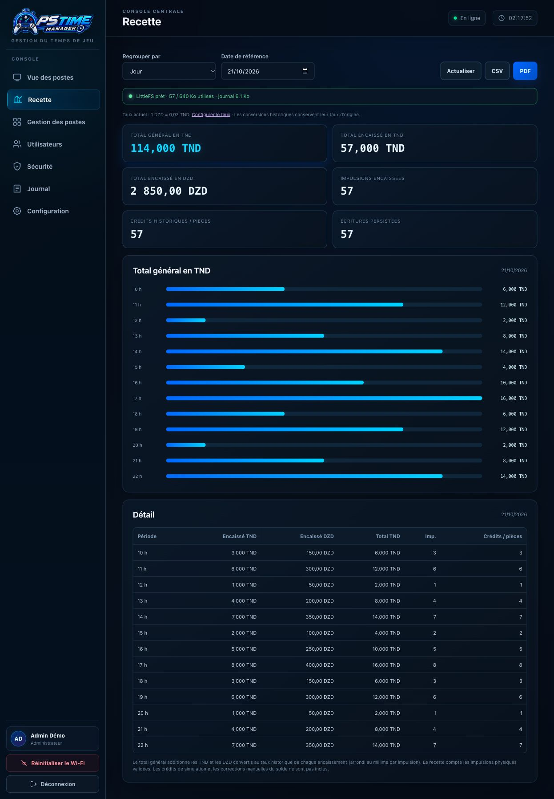

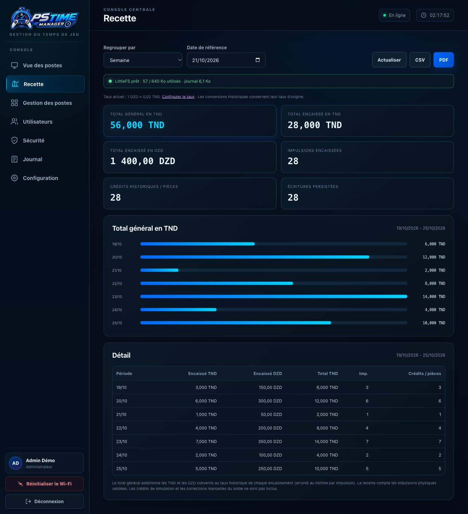

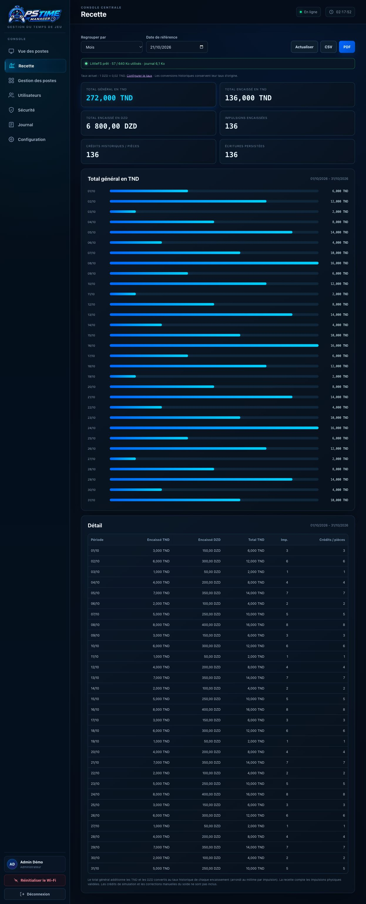

## 25. Administrateur : exporter la recette en CSV ou PDF

**Prérequis :** période chargée dans **Recette**, sans erreur empêchant la lecture.

### Exporter en CSV

1. Vérifier **Regrouper par**, la date de référence et la plage affichée.
2. Cliquer sur **CSV**.
3. Vérifier le téléchargement du fichier `.csv`, puis l’ouvrir dans l’outil de tableur utilisé par la salle.
4. Comparer les montants et la période avec l’écran avant de transmettre le rapport.

**Résultat attendu :** le fichier contient les agrégats TND/DZD, le total converti et les compteurs de la période.

### Exporter en PDF

1. Vérifier la période et les montants à l’écran.
2. Cliquer sur **PDF**.
3. Vérifier le téléchargement du fichier `.pdf`, puis l’ouvrir.
4. Contrôler la période et toutes les pages du détail avant impression ou archivage.

**Résultat attendu :** le navigateur produit un rapport lisible, paginé si nécessaire. Ces exports sont des rapports agrégés, pas une sauvegarde restaurable du journal financier.

## 26. Administrateur : créer un compte

**Prérequis :** moins de dix comptes enregistrés. **Emplacement :** **Utilisateurs > Ajouter un utilisateur**.

1. Saisir **Nom d’utilisateur**, de 3 à 32 caractères : lettres de a à z, chiffres, point, tiret ou soulignement. Le serveur normalise le nom en minuscules.
2. Renseigner **Prénom** et **Nom**, non vides et limités à 64 caractères chacun.
3. Définir **Mot de passe**, au moins six caractères. Utiliser le bouton d’affichage pour contrôler la saisie si nécessaire.
4. Choisir **Utilisateur simple** pour l’exploitation des sessions, ou **Administrateur** pour les fonctions de gestion.
5. Cliquer sur **Ajouter l’utilisateur**.
6. Lire le message de réussite et vérifier le nouveau compte dans **Comptes existants**.

**Résultat attendu :** le compte dispose du rôle choisi et peut se connecter avec ses identifiants. Un nom déjà utilisé ou des champs invalides doivent être corrigés avant création.

## 27. Administrateur : modifier ou supprimer un compte

**Emplacement :** **Utilisateurs > Comptes existants**.

### Modifier l’identité, le rôle ou le mot de passe d’un autre compte

1. Repérer le compte et cliquer sur **Modifier**.
2. Changer **Prénom**, **Nom** ou **Rôle** selon le besoin.
3. Pour réinitialiser le mot de passe d’un autre compte, remplir **Nouveau mot de passe (facultatif)** avec au moins six caractères. Laisser vide pour le conserver.
4. Cliquer sur **Enregistrer**, lire le résultat et vérifier les valeurs affichées.
5. Informer l’opérateur concerné qu’une reconnexion peut être nécessaire après changement de rôle ou de mot de passe.

**Résultat attendu :** les informations du compte sont actualisées. Le compte courant ne peut pas changer son propre rôle ; son propre mot de passe se modifie dans **Sécurité**. Le dernier administrateur ne peut pas être rétrogradé.

### Supprimer un compte

1. Vérifier le compte visé, puis cliquer sur **Supprimer**.
2. Lire la confirmation et confirmer la suppression du bon identifiant.
3. Vérifier sa disparition de la liste.

**Résultat attendu :** le compte est supprimé et ses sessions sont invalidées. Le compte courant et le dernier administrateur sont protégés contre la suppression.

## 28. Administrateur : changer son mot de passe

**Prérequis :** session administrateur ouverte. **Emplacement :** **Sécurité > Mot de passe administrateur**.

1. Saisir **Nouveau mot de passe**, au moins six caractères ; choisir une valeur difficile à deviner.
2. Saisir exactement la même valeur dans **Confirmer le mot de passe**.
3. Utiliser les boutons d’affichage et les indications de concordance si nécessaire. Le bouton de validation reste désactivé tant que les champs ne sont pas valides et identiques.
4. Cliquer sur **Changer le mot de passe**.
5. Confirmer la lecture du message, puis se reconnecter avec le nouveau mot de passe lorsque demandé.

**Résultat attendu :** le nouveau mot de passe remplace l’ancien. Un utilisateur simple doit demander à un administrateur la modification de son mot de passe depuis la gestion des comptes.

## 29. Administrateur : consulter et régénérer le token API

**Prérequis :** connaître les clients utilisant l’API et pouvoir mettre à jour leur configuration. **Emplacement :** **Sécurité > Token API**.

1. Lire la valeur affichée. Si elle est masquée, **Copier le token affiché** copie cette représentation, pas le secret complet.
2. Pour remplacer le token, cliquer sur **Régénérer le token API**.
3. Lire la confirmation indiquant que les anciens clients devront être mis à jour, puis confirmer si le remplacement est voulu.
4. Copier immédiatement le nouveau token complet et le conserver dans un emplacement protégé. Il sera masqué au prochain chargement.
5. Mettre à jour les clients autorisés avec `Authorization: Bearer VOTRE_TOKEN_API`.

**Résultat attendu :** l’ancien token ne fonctionne plus et les clients configurés avec le nouveau peuvent utiliser l’API selon les droits prévus. Le secret compilé entre centrale et postes n’est pas modifié.

L’application utilise HTTP sur le LAN. Les indications **État de la sécurité** ne remplacent pas la protection effective du réseau et des accès.

## 30. Administrateur : lire et vider le journal

**Emplacement :** **Journal**.

### Consulter les événements

1. Ouvrir **Journal**.
2. Lire le niveau, le message et l’heure relative au démarrage de chaque événement.
3. Utiliser **Actualiser** pour une lecture immédiate ; la page se recharge aussi automatiquement toutes les cinq secondes.
4. Relever le message exact si une erreur doit être diagnostiquée.

**Résultat attendu :** les événements récents aident à suivre les postes, le monnayeur et le stockage. Le journal contient au plus 100 événements en RAM et est perdu au redémarrage.

### Vider le journal

1. Relever les informations utiles avant effacement.
2. Cliquer sur **Vider le journal**.
3. Lire et confirmer le vidage définitif, ou annuler pour conserver les messages.
4. Vérifier que la liste est vidée ; de nouveaux événements peuvent ensuite apparaître.

**Résultat attendu :** les logs RAM sont effacés sans supprimer la recette LittleFS.

## 31. Administrateur : réinitialiser le Wi-Fi de la centrale

**Prérequis :** connaître le réseau de destination et pouvoir rejoindre physiquement le point d’accès de configuration après redémarrage.

1. Ouvrir le menu administrateur.
2. Cliquer sur **Réinitialiser le Wi-Fi**.
3. Lire la confirmation demandant la suppression du réseau et le redémarrage. Confirmer si l’opération est voulue.
4. Attendre le redémarrage, puis rejoindre `GAMEROOM-CENTRAL-<chipId>`.
5. Ouvrir `http://192.168.4.1` et suivre la procédure de connexion réseau de la centrale.

**Résultat attendu :** les paramètres réseau de la centrale sont effacés et son portail de configuration est ouvert. Ce bouton ne réinitialise pas les réseaux des postes.

## 32. Connecter la centrale : DHCP ou IP fixe

**Accès :** personne chargée de la mise en réseau. **Prérequis :** accès au portail de configuration de la centrale et identifiants Wi-Fi disponibles.

1. Rejoindre `GAMEROOM-CENTRAL-<chipId>` puis ouvrir `http://192.168.4.1` si nécessaire.
2. Cliquer sur **Actualiser** pour relancer la recherche de réseaux.
3. Sélectionner le réseau voulu, ou remplir **SSID** manuellement, puis saisir **Mot de passe**.
4. Conserver **Automatique (DHCP)** si le routeur attribue les IP.
5. Pour une adresse fixe, choisir **Manuelle (IP fixe)**, puis renseigner **Adresse IP fixe**, **Passerelle** et **Masque de sous-réseau**. Ajouter les DNS si nécessaires.
6. Cliquer sur **Enregistrer et connecter**. En cas d’échec, corriger les paramètres.
7. Après succès, noter l’IP, attendre le redémarrage et reconnecter l’ordinateur au LAN.
8. Ouvrir la nouvelle IP de la centrale ou `http://pstm.local`.

**Résultat attendu :** la centrale rejoint le réseau choisi et son interface est accessible. Les paramètres sont enregistrés après connexion réussie.

## 33. Connecter un poste : DHCP ou IP fixe

**Accès :** personne chargée de la mise en réseau. **Prérequis :** poste en mode configuration, même réseau cible que la centrale et secret commun déjà programmé.

1. Rejoindre `GAMEROOM-POSTE-<chipId>` et ouvrir `http://192.168.4.1`.
2. Sélectionner le réseau local commun à la centrale, ou saisir son SSID ; renseigner le mot de passe.
3. Choisir DHCP, ou IP fixe avec une adresse libre propre à ce poste, la passerelle et le masque. Les DNS sont facultatifs.
4. Cliquer sur **Enregistrer et connecter**, puis attendre le résultat.
5. Après succès, rejoindre à nouveau le LAN avec le navigateur.
6. Dans la centrale, vérifier le poste dans **Gestion des postes**, puis l’associer s’il n’est pas encore configuré.

**Résultat attendu :** le poste rejoint le LAN et annonce son état. Le tarif se règle dans la centrale. Le portail `/wifi` n’est accessible que pendant le mode configuration ; il n’existe pas de bouton web local de réinitialisation Wi-Fi du poste.

## 34. Consulter directement l’état d’un poste

**Accès :** personne disposant de l’IP du poste sur le LAN. **Prérequis :** poste connecté au réseau.

1. Ouvrir `http://IP_DU_POSTE/` dans un navigateur.
2. En mode normal, vérifier la réponse **Poste OK**. Elle confirme la réponse HTTP, pas l’état physique du relais.
3. Pour plus de détails, ouvrir `http://IP_DU_POSTE/status`.
4. Lire `name`, `ip`, `status`, `relay`, `remaining`, `recoveryPending` et `recoveryRemaining`. L’état expose aussi l’identité et le marqueur de configuration.
5. Pour commander une session, revenir à la carte du poste dans la centrale.

**Résultat attendu :** vous obtenez un état JSON, dont la présentation dépend du navigateur. Le poste ne fournit pas de tableau de bord local de session.

## 35. Administrateur : résoudre un débit interrompu

**Prérequis :** message d’affectation interrompue et panneau de résolution dans **Configuration**. Ne pas confondre cet incident de débit central avec une reprise de session sauvegardée sur un poste.

1. Suspendre les nouvelles attributions et repérer le poste concerné par l’incident.
2. Vérifier directement son temps et son état pour déterminer si la commande a ajouté la durée. Un timeout ne prouve pas l’échec de la commande.
3. Ouvrir **Configuration** et lire le message associé à l’affectation interrompue.
4. Si le temps a été ajouté, cliquer sur **Confirmer le débit**, lire puis confirmer la décision.
5. Si le temps n’a pas été ajouté, cliquer sur **Annuler le débit**, lire puis confirmer la conservation des pièces.
6. Vérifier le message de résolution, le solde et la disponibilité des attributions avant de reprendre le service.

**Résultat attendu :** la centrale règle le débit incertain selon le résultat constaté. En cas de doute sur le poste ou de défaut de stockage persistant, solliciter la maintenance avant de répéter une commande.

## 36. Organiser le service et traiter les problèmes

**Accès :** utilisateur simple pour les sessions ; administrateur pour les réglages, exports et incidents de stockage.

1. À l’ouverture, consulter les postes, les reprises et le solde. L’administrateur vérifie aussi la recette, le stockage et l’horloge.
2. Avant chaque attribution, contrôler le poste demandé, son tarif et le solde suffisant.
3. Après une commande, lire son résultat et le nouvel état avant toute nouvelle action.
4. À la fermeture, vérifier les sessions restantes ; l’administrateur exporte les rapports voulus et sauvegarde les réglages après modification.
5. Se déconnecter à la fin du service.

| Problème | Action utilisateur | Action administrateur ou maintenance |
|---|---|---|
| Connexion refusée | Corriger la saisie ; demander une réinitialisation si nécessaire | Contrôler le compte et le rôle |
| Bouton +N indisponible | Lire le motif et vérifier le solde | Traiter reprise ou défaut de stockage |
| Poste hors ligne | Vérifier le bon poste et signaler la panne | Alimentation, IP, Ping, /status et secret commun |
| Résultat incertain après timeout | Ne pas répéter aveuglément | Vérifier le poste et résoudre le débit si le panneau apparaît |
| Pièce ignorée | Attendre Monnayeur prêt et signaler l’incident | Contrôler signal, GPIO13, rappel et anti-doublon |
| Recette non datée | Signaler l’anomalie | Vérifier NTP ; consulter les montants non datés |
| Stockage en erreur | Relever le message | Diagnostiquer sans formater ni effacer la flash |
| Portail absent | Vérifier le réseau rejoint | Ouvrir 192.168.4.1 et consulter le moniteur série |
